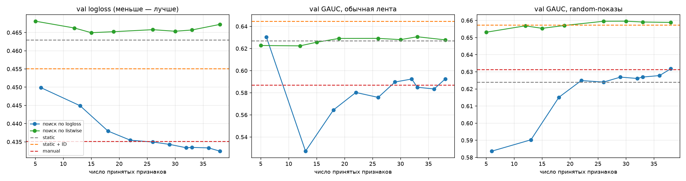
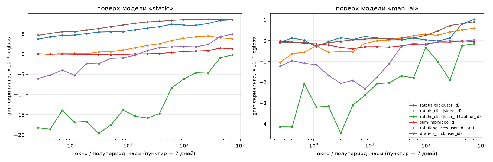
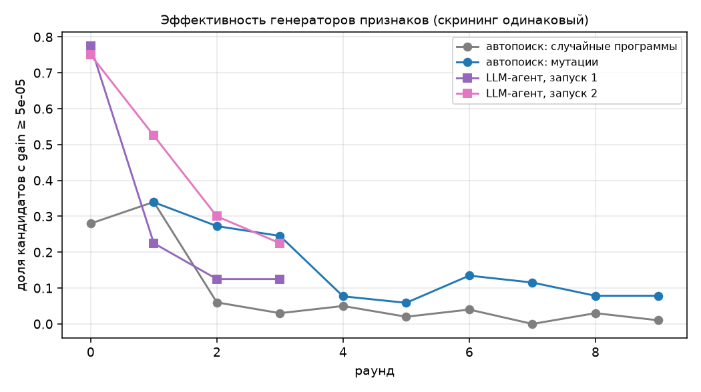

# Задание 1. Автоматизация генерации признаков для рекомендательного бустинга

> T-Lab 2026, RecSys. Код — `src/`, тесты — `tests/`, результаты (JSON, логи, графики) — `results/`,
> материалы LLM-агента — `agent/`. Всё посчитано на ноутбуке без GPU (4 ядра, 16 ГБ RAM).
> Каждое число в отчёте берётся из файлов в `results/` (таблица соответствия — в конце, §9).

## Оглавление
0. [Кратко (TL;DR)](#tldr)
1. [Данные и постановка](#1)
2. [Протокол оценки](#2)
3. [Бейзлайн: бустинг на ручных признаках](#3)
4. [Идея: признак — типизированная программа (DSL), компилируемая в SQL](#4)
5. [Автоматический поиск признаков](#5)
6. [LLM-агент как генератор признаков](#6)
7. [Результаты](#7)
8. [Выводы, ограничения, что дальше](#8)
9. [Воспроизведение и где лежат числа](#9)
10. [Приложения](#10)

<a id="tldr"></a>
## 0. Кратко (TL;DR)

**Задача.** Предсказание клика по показу видео (KuaiRand-Pure, 2.6M показов) бустингом LightGBM. Сначала —
хороший бейзлайн на ручных point-in-time признаках истории; затем — способ автоматизировать придумывание
признаков, который обходит бустинг на ручных признаках с подбором гиперпараметров.

**Идея.** Признак истории — это не строка SQL, а **типизированная программа** в маленьком DSL:
`AGG(сигнал WHERE фильтр трафика GROUP BY ключ OVER окно)` (§4). Каждая программа компилируется в быстрый
numpy/numba-код и в эталонный SQL; семантика «только события строго до момента показа» зашита в компилятор и
проверена тестами, поэтому **любой генератор признаков физически не может сделать утечку**. Поверх DSL:
* **автоматический поиск** (§5): случайные программы + мутации лучших, скрининг «польза признака *поверх
  текущей модели*» (маленький бустинг по остаткам с перекалибровкой), отбор best-first без дубликатов;
* **LLM-агент** (§6): Claude без доступа к данным предлагает спецификации DSL и получает обратную связь от того
  же скрининга; плюс гибрид «агент + поиск».

**Результаты** (test 05–08.05, среднее по 3 сидам LightGBM; полная таблица — §7.1, ДИ — §7.2):

| набор признаков | # признаков истории | test logloss ↓ | test AUC ↑ | GAUC random ↑ | NDCG@10 random ↑ |
|---|---|---|---|---|---|
| только статические | 0 | 0.4595 | 0.7229 | 0.6232 | 0.6747 |
| ручной набор (бейзлайн) | 40 | 0.4289 | 0.7834 | 0.6378 | 0.6785 |
| ручной набор + тюнинг LightGBM | 40 | 0.4292 | 0.7831 | 0.6376 | 0.6774 |
| AutoFE, цель logloss | 38 | 0.4245 | 0.7845 | 0.6397 | 0.6804 |
| AutoFE, цель listwise | 38 | 0.4675 | 0.7190 | **0.6575** | **0.7016** |
| LLM-агент (2 независимых запуска) | 16 / 19 | 0.4219 / 0.4217 | 0.7887 / 0.7898 | 0.6479 / 0.6468 | 0.6870 / 0.6873 |
| **LLM-агент + поиск** | 30 | **0.4198** | **0.7908** | 0.6477 | 0.6864 |

**Главные выводы.**
1. **Автоматизация обходит бустинг с подбором гиперпараметров.** Подбор гиперпараметров LightGBM на ручных
   признаках (12 случайных конфигураций по val; лучшая не лучше конфигурации по умолчанию) не даёт ничего
   (0.4289 → 0.4292), а автоматически найденные признаки улучшают logloss на 0.004 (поиск),
   0.007 (LLM-агент) и 0.009 (агент + поиск) без участия человека. Улучшение logloss значимо (парный бутстрап, 95% ДИ)
   и на обычной ленте, и на random-показах; на random-показах значимо лучше и ранжирование (GAUC, NDCG@10), на
   ленте — только у LLM-агента (запуск 1) и гибрида.
2. **Цель поиска важнее точности окон.** Признаки, найденные под logloss, почти не улучшают ранжирование видео
   внутри пользователя (как и ручные: GAUC обычной ленты у ручного набора даже хуже, чем у одних статических
   признаков). Тот же поиск под **listwise-цель** находит другие, item-side признаки (ни одного с ключом
   `user_id`) и даёт лучшее ранжирование random-показов среди всех наборов признаков истории (GAUC 0.6575,
   NDCG@10 0.7016; на ленте — лишь на уровне одних статических признаков, 0.621 против 0.622) — ценой
   калибровки (§7.3–7.4).
3. **«7 дней или 10?»** Для отдельного признака окно важно: оптимум на этих данных — 11–30 дней, gain при нём
   до 2.7 раза больше, чем при 7 днях, а короткие окна у редких ключей вредны из-за дрейфа. Но поиск по сетке
   {1ч, 1д, 7д, ∞} (в нашей постановке — ещё и без затуханий) даёт итоговую модель того же качества, что и поиск
   по непрерывным окнам (§7.5).
4. **LLM-агент — самый эффективный генератор**: 75–78% полезных предложений в первом раунде против 28% у
   случайных программ; 160 его предложений дают больше, чем 1 321 кандидат поиска; два запуска сходятся по
   logloss/AUC и ранжированию random-показов (на ленте — нет). Лучшая точечная оценка logloss/AUC — у
   комбинации: агент задаёт стартовый набор, поиск дорабатывает его мутациями (один запуск, §7.6).
5. **Без отбора грамматика почти бесполезна**: набор из 38 случайных программ без скрининга (одна выборка) почти не
   улучшает logloss и ухудшает ранжирование random-показов (GAUC 0.521 против 0.623 у статических признаков) —
   основная ценность в скрининге «поверх модели».

---

<a id="1"></a>
## 1. Данные и постановка

### 1.1. Датасет
**KuaiRand-Pure** (Kuaishou, 08.04–08.05.2022; [kuairand.com](https://kuairand.com/), Zenodo 10439422) выбран
потому, что он ровно соответствует описанию из условия: каждая строка — *показ* `(user, video, timestamp)`
с несколькими откликами разной «глубины» (`is_click`, `long_view`, `is_like`, `is_follow`, `is_comment`,
`is_forward`, `is_hate`, `is_profile_enter`, время просмотра), у пользователей и видео есть категориальные
признаки (у видео — автор, музыка, тег, тип, длительность; у пользователя — степень активности, диапазоны
числа подписок/подписчиков/друзей, «возраст» аккаунта, 18 анонимных one-hot признаков).

Важная особенность датасета — **два вида показов**:
* обычная лента (`is_rand=0`, CTR ≈ 46%) — то, что показала рекомендательная система Kuaishou;
* **случайные показы** (`is_rand=1`, CTR ≈ 18%) — видео, подставленные в ленту случайно; на них можно честно
  мерить ранжирование без смещения от предыдущей рекомендательной системы.

Все три лога (стандартный 08.04–21.04, стандартный 22.04–08.05, случайный 22.04–08.05) объединены в одну
хронологическую таблицу из 2.62M показов (`src/data.py`).

### 1.2. Задача и разбиение
* **Таргет** — `is_click` (бинарная классификация показа), модель — LightGBM.
* **Разбиение строго по времени** (по локальной дате показа):

| | warmup (только история) | train | val | test |
|---|---|---|---|---|
| даты | 08.04–14.04 | 15.04–30.04 | 01.05–04.05 | 05.05–08.05 |
| показов | 0.89M | 0.81M | 0.44M | 0.48M |
| доля random-показов | 0% | 49% | 83% | 88% |
| CTR | 0.457 | 0.321 | 0.226 | 0.212 |

* Обучение — на train, ранняя остановка и подбор гиперпараметров — по val, test используется только для
  итоговых чисел. Внутри train-периода для автоматического поиска выделены подпериоды:
  `fit` 15.04–26.04, `screen_a` 27.04–28.04, `screen_b` 29.04–30.04 (§5). Поиск никогда не видит val/test:
  он работает на копии таблицы, физически обрезанной по 30.04.

### 1.3. Защита от утечек
Любой признак истории для показа в момент `t` считается **только по событиям с меткой времени строго меньше
`t`**. Одновременные события (одна и та же миллисекунда — 4.1% пар соседних показов одного пользователя,
`results/data_stats.json`)
друг другу не видны. Это свойство *движка* (§4.2), а не дисциплины автора признака; оно проверяется
автоматически (`tests/test_engine.py`, §4.3).

Отдельно проверен «лаг метки»: клик/время просмотра предыдущего показа известны только после того, как
пользователь досмотрел видео. Среди пар соседних показов одного пользователя с разными метками времени доля
пар, где следующий показ начался до окончания просмотра предыдущего, — 0.17% (`src/data_stats.py`), т.е. использование «вчерашних по миллисекундам» откликов
практически не создаёт утечки. (Проверены только соседние показы одного пользователя; «незавершённые» отклики
других пользователей в агрегатах по видео/автору отдельно не изучались.) Статичные профильные признаки пользователя (snapshot из датасета) используются
как есть — это стандартная практика для KuaiRand.

<a id="2"></a>
## 2. Протокол оценки

* **Метрики** на test, отдельно для обычной ленты и для random-показов:
  * `logloss`, `AUC` — поточечное качество предсказания клика;
  * `GAUC` — AUC внутри группы «пользователь × день × тип трафика», усреднённый с весами = размер группы
    (используются группы, где есть и клик, и не-клик; ~35 тыс. групп). Ничьи по скору учитываются средними
    рангами;
  * `NDCG@10` внутри тех же групп (релевантность = клик).

  GAUC и NDCG — это **качество ранжирования видео для конкретного пользователя**, т.е. ровно то, что важно
  рекомендательной системе. `logloss`/`AUC` в значительной мере измеряют, насколько хорошо модель различает
  *пользователей* и *контексты* (кто в целом кликает чаще).
* **Каждая конфигурация обучается с 3 сидами** LightGBM; в таблицах README — среднее, со стандартным отклонением — в `results/summary_tables.md`.
* **Доверительные интервалы** для разницы с ручным набором признаков: парный бутстрап по группам
  «пользователь × день» (1000 повторов, предсказания сида 0), отдельно для ленты и random-показов
  (`src/exp_final.py`).
* Параметры LightGBM по умолчанию: `num_leaves=63, lr=0.05, min_data_in_leaf=200, feature_fraction=0.8,
  bagging 0.8, lambda_l2=1`, ранняя остановка по val logloss (50 раундов). Для части наборов дополнительно
  сделан случайный поиск гиперпараметров (12 конфигураций по val logloss).

<a id="3"></a>
## 3. Бейзлайн: бустинг на ручных признаках

**Статические признаки** (есть во всех моделях, 44 шт.): профиль пользователя (8 категориальных + 22 числовых),
атрибуты видео (тип, тип загрузки, тип музыки, основной тег, бакет длительности, длительность, разрешение,
число тегов), контекст (вкладка приложения, тип показа, час, день недели, возраст видео в часах).

**Ручной набор** (`src/features.py:MANUAL`, 40 признаков, полный список — Приложение A) — то, что типичный
инженер написал бы за день:
* пользователь: число показов за 1ч/1д/7д/всё время, клики за 1д/7д, сглаженный CTR за 7д/всё время, доли
  long_view и лайков, средняя доля просмотра, время с последнего показа и последнего клика, CTR по типу показа;
* видео: число показов и CTR за 1д/7д/всё время, доли long_view/лайков, средняя доля просмотра;
* автор/музыка/тег: число показов и CTR за 7д;
* пары: user×video (показы, клики, давность), user×author (показы, клики, CTR), user×tag (за 7д и всё время),
  user×music (клики), video×сегмент пользователя (CTR).

Окна — «круглые» (1 час, 1 день, 7 дней, всё время), CTR сглаживается априорным средним (§4.1).

Дополнительно оцениваются: «только статические признаки» и «статические + категориальные ID»
(`user_id, video_id, author_id, music_id` как категориальные признаки LightGBM — модель «запоминает» объекты
без всякой истории).

<a id="4"></a>
## 4. Идея: признак — это типизированная программа, а не строка SQL

### 4.1. DSL реляционных агрегатов
Почти любой «ручной» признак в RecSys — агрегат по таблице событий за окно до текущего момента. Мы фиксируем
это как грамматику (`src/engine.py:Spec`):

```
feature := AGG( SIGNAL  WHERE FILTER  GROUP BY KEY  OVER WINDOW )      — только по событиям строго до t
AGG     := sum                      сумма сигнала за окно
         | rate                     сглаженное среднее: (Σ сигнал + α·prior(t)) / (число событий + α)
         | recency                  секунд с последнего события, где сигнал > 0
         | dsum | drate             то же, что sum/rate, но с экспоненциальным затуханием (полупериод вместо окна)
SIGNAL  := imp | is_click | long_view | is_like | is_follow | is_comment | is_forward | is_hate
         | is_profile_enter | play_ratio (доля просмотра, ≤1) | play_s (секунды просмотра, ≤600)
FILTER  := all | std (только обычная лента) | rand (только random-показы) | clicked (только кликнутые)
KEY     := 1–3 колонки: user-side {user_id, user_active_degree, is_video_author, follow_user_num_range,
           fans_user_num_range, register_days_range, is_lowactive_period},
           item-side {video_id, author_id, music_id, tag, video_type, upload_type, music_type, dur_bucket},
           context {tab, is_rand, hour}
WINDOW  := любое положительное число секунд или ∞ (для dsum/drate — полупериод)
α       := сила априорного сглаживания (1…100)
```

`prior(t)` — **point-in-time** глобальное среднее сигнала среди отфильтрованных событий строго до `t`:
`(Σ сигнал до t + 0.5) / (число событий до t + 1)`. (Первая версия брала константный prior по warmup-неделе,
в которой нет random-показов, — для фильтра `rand` prior получался 0; это нашёл код-ревью и исправлено до
всех финальных экспериментов.)

Пример: `rate(is_click | user_id+author_id | std | w=7d | α=10)` — сглаженный CTR этого пользователя на видео
этого автора в обычной ленте за последние 7 дней. Генератор поиска берёт в ключ не больше одной колонки из
каждой группы (user-side, item-side, context), так что размер пространства — ~280 ключей × 11 сигналов ×
4 фильтра × 5 агрегатов × непрерывное окно × α.

### 4.2. Компилятор: одна спецификация → быстрый код и эталонный SQL
Каждая спецификация компилируется в два исполнителя:
* **быстрый** (numpy + numba, `Engine.compute`): события сортируются по `(ключ, t)` (стабильная сортировка
  по целочисленному ключу — таблица уже упорядочена по времени), оконные суммы считаются через префиксные
  суммы и `searchsorted`, затухающие суммы — однопроходным сканом с корректной обработкой блоков одновременных
  событий, давность — через накопленный максимум индексов. На 2.6M событий признак считается за 0.3–2.5 с (с учётом сортировки по ключу),
  причём можно считать только нужные строки (`rows=`);
* **эталонный SQL** (DuckDB, `Spec.to_sql`): оконные функции
  `SUM(...) OVER (PARTITION BY key ORDER BY t RANGE BETWEEN w PRECEDING AND 1 PRECEDING)`, для затухания —
  self-join. Так признак «выглядел бы, если бы его написал человек» (примеры — Приложение B).

### 4.3. Корректность по построению
`tests/test_engine.py` на подвыборке из 300 пользователей проверяет:
1. **быстрый движок ≡ SQL** на 9 спецификациях, покрывающих все 5 агрегатов, 4 фильтра и ключи из 1–2 колонок (максимальная
   относительная ошибка 6·10⁻⁸ — точность float32);
2. **подсчёт на подмножестве строк ≡ подсчёт на всех**;
3. **пробу на утечку**: если инвертировать метки всех событий начиная с момента `t0`, ни одно значение
   признака в моменты `≤ t0` не меняется.

Поэтому генератор признаков — человек, алгоритм или LLM — **физически не может сделать лик**: он пишет
спецификацию, а не запрос, а семантика «строго до t» зашита в компилятор.

<a id="5"></a>
## 5. Автоматический поиск признаков

`src/autofe.py:search`. Поиск идёт раундами; все решения принимаются только на train-периоде.

**Шаг 1. Базовая модель.** LightGBM (lr 0.1, ранняя остановка по `screen_a`) на днях `fit` со статическими
признаками и всеми уже принятыми. Её скоры на днях `screen_a` и `screen_b` **перекалибруются** логистической
регрессией (Platt) на `screen_a` отдельно для ленты и random-показов.

**Шаг 2. Кандидаты.** 100 случайных программ из грамматики (окна — лог-равномерно от 10 минут до 30 дней,
с вероятностью 15% — ∞; полупериоды — от 10 минут до 10 дней) + 60 мутаций лучших найденных ранее
(мутации: окно ×e^N(0,0.7), сигнал, фильтр, агрегат, замена/добавление/удаление колонки ключа, α для rate).

**Шаг 3. Скрининг — польза кандидата *поверх текущей модели*.** На одном признаке-кандидате обучается
маленький бустинг (7 листьев, 40 деревьев, lr 0.1) с `init_score` = перекалиброванные скоры базовой модели —
на `screen_a`; gain = уменьшение logloss на `screen_b`. Это одномерный «шаг бустинга по остаткам»: он
оценивает не связь признака с таргетом, а **информацию, которой ещё нет в модели**.

**Шаг 4. Отбор best-first с условной пользой.** Из 16 лучших кандидатов по одному выбирается тот, у кого
максимален gain *при условии уже принятых в этом раунде* (поправка от принятого признака добавляется к
базовым скорам — forward stagewise), отсекаются почти-дубликаты (|Spearman| > 0.95 с уже принятыми), порог
gain ≥ 5·10⁻⁵, не более 8 признаков за раунд. Поиск останавливается через заданное число раундов или когда в
раунде ничего не принято.

**Две ловушки, найденные в процессе (обе есть в любой подобной системе):**
* *Калибровка вместо информации.* Без перекалибровки почти любой признак давал ~5·10⁻⁴ gain (наблюдение при
  разработке; в итоговых файлах не сохранено): маленький
  бустинг просто исправлял сдвиг CTR между днями (дрейф данных), а не добавлял информацию. После Platt-шага
  этот «пол» исчез, и gain-ы стали различимы.
* *Избыточность.* При отборе top-k по маргинальному gain раунд заполнялся вариантами одного и того же
  («CTR пользователя» 8 разными способами). Условный отбор это устранил.

**Цель скрининга — ручка, которая определяет, что найдёт поиск.** Реализованы две:
* `logloss` — поточечный logloss (как выше);
* `listwise` — средний по группам «пользователь × день × тип трафика» listwise-loss
  `−mean_{кликнутые i} log softmax_группа(score)_i`. Он **инвариантен к сдвигу скоров пользователя целиком**,
  поэтому вознаграждает только признаки, различающие *видео для одного и того же пользователя*.

**Варианты и абляции поиска:**
* `autofe_logloss` — основной поиск (10 раундов, цель logloss), 3 независимых сида поиска;
* `autofe_logloss_grid` — тот же поиск, но окна только из «человеческой» сетки {1ч, 1д, 7д, ∞} и без
  затуханий, 6 раундов, 3 сида — проверка, нужны ли непрерывные окна;
* `autofe_listwise` — поиск с целью listwise (8 раундов);
* `random DSL` — столько же (38) случайных программ из грамматики **без** скрининга и отбора;
* `llm_agent+search` — гибрид (§6): признаки LLM-агента (запуск 1) как стартовый набор и первые «родители»
  мутаций, затем 5 раундов поиска (40 случайных программ + 110 мутаций за раунд вместо 100 + 60).

<a id="6"></a>
## 6. LLM-агент как генератор признаков

Гипотеза из условия — «может, ИИ-агент напишет фичи за нас лучше?». DSL делает это безопасным: агент выдаёт
JSON-спецификации, а не SQL, поэтому не может ни сломать пайплайн, ни сделать утечку.

**Протокол** (`agent/`, `src/agent_round.py`, `src/agent_feedback.py`):
* агент — под-агент Claude без доступа к инструментам (не читает файлы, не запускает код); роль —
  «senior RecSys engineer»; промпт — `agent/prompt_round0.md`: описание задачи, данных, статических признаков,
  полная грамматика DSL и правило оценки;
* 4 раунда × 40 предложений; предложения оцениваются **тем же** скринингом, что и в автоматическом поиске;
* после каждого раунда агент получает только список принятых признаков и измеренные gain-ы своих предложений
  на `screen_b` (тексты — `agent/feedback_r*.txt`); метрики val/test агент не видит;
* проведено **два независимых запуска** (новый агент, тот же промпт): `agent/` и `agent/run2/`.
  Первый запуск шёл интерактивно, пока исправлялись детали скрининга (перекалибровка, prior), поэтому его
  4 раунда предложений затем были **пере-оценены** финальной версией скрининга (`agent_state.json`);
  второй запуск целиком прошёл на финальной версии.

<a id="7"></a>
## 7. Результаты

### 7.1. Основная таблица (test, среднее по 3 сидам LightGBM)

«#» — число признаков модели (44 статических + признаки истории). GAUC/NDCG — внутри групп «пользователь ×
день» отдельно для обычной ленты и random-показов. Жирным — лучший результат в столбце среди наборов с
признаками истории (static и варианты с категориальными ID в сравнении не участвуют).

| набор признаков | # | val logloss | test logloss | test AUC | GAUC лента | NDCG@10 лента | GAUC random | NDCG@10 random |
|---|---|---|---|---|---|---|---|---|
| static (только статические) | 44 | 0.4630 | 0.4595 | 0.7229 | 0.6217 | 0.8320 | 0.6232 | 0.6747 |
| static + ID (запоминание объектов) | 48 | 0.4551 | 0.4530 | 0.7372 | 0.6380 | 0.8401 | 0.6559 | 0.7034 |
| **manual** (40 ручных признаков) | 84 | 0.4352 | 0.4289 | 0.7834 | 0.5744 | 0.8094 | 0.6378 | 0.6785 |
| manual, тюнинг LightGBM | 84 | 0.4355 | 0.4292 | 0.7831 | 0.5731 | 0.8083 | 0.6376 | 0.6774 |
| random DSL (38 случайных программ, без отбора) | 82 | 0.4605 | 0.4531 | 0.7414 | 0.5811 | 0.8126 | 0.5206 | 0.5877 |
| **AutoFE, цель logloss** (38 признаков) | 82 | 0.4324 | 0.4245 | 0.7845 | 0.5811 | 0.8122 | 0.6397 | 0.6804 |
| AutoFE logloss, тюнинг LightGBM | 82 | 0.4324 | 0.4245 | 0.7845 | 0.5816 | 0.8142 | 0.6417 | 0.6818 |
| AutoFE, окна только {1ч,1д,7д,∞} (27 признаков) | 71 | 0.4320 | 0.4237 | 0.7869 | 0.5859 | 0.8137 | 0.6450 | 0.6842 |
| **AutoFE, цель listwise** (38 признаков) | 82 | 0.4677 | 0.4675 | 0.7190 | **0.6206** | **0.8318** | **0.6575** | **0.7016** |
| **LLM-агент**, запуск 1 (16 признаков) | 60 | 0.4304 | 0.4219 | 0.7887 | 0.5956 | 0.8197 | 0.6479 | 0.6870 |
| LLM-агент, запуск 2 (19 признаков) | 63 | 0.4300 | 0.4217 | 0.7898 | 0.5525 | 0.7982 | 0.6468 | 0.6873 |
| **LLM-агент + поиск** (16 + 14 признаков) | 74 | **0.4289** | **0.4198** | **0.7908** | 0.5994 | 0.8209 | 0.6477 | 0.6864 |
| manual ∪ AutoFE logloss | 122 | 0.4301 | 0.4218 | 0.7885 | 0.5778 | 0.8108 | 0.6473 | 0.6860 |
| AutoFE logloss ∪ AutoFE listwise | 119 | 0.4327 | 0.4252 | 0.7842 | 0.5843 | 0.8143 | 0.6383 | 0.6791 |
| AutoFE logloss ∪ listwise + ID | 123 | 0.4358 | 0.4283 | 0.7795 | 0.6108 | 0.8266 | 0.6423 | 0.6854 |
| manual + ID | 88 | 0.4410 | 0.4368 | 0.7788 | 0.6009 | 0.8220 | 0.6489 | 0.6911 |

Стандартное отклонение по 3 сидам LightGBM (`np.std`, ddof=0) — ≤0.0011 по test logloss и ≤0.0033 по GAUC/NDCG, т.е.
различия в третьем знаке logloss между наборами устойчивы к сиду модели (но см. §7.7 про разброс самого поиска).

### 7.2. Значимость: разница с ручным набором

Парный бутстрап по группам «пользователь × день» (1000 повторов, модель с сидом 0), отдельно для ленты и
random-показов; **жирным** — 95% ДИ не содержит 0. Отрицательный Δlogloss — лучше; положительные ΔGAUC/ΔNDCG —
лучше.

| набор | Δlogloss лента | ΔGAUC лента | ΔNDCG@10 лента | Δlogloss random | ΔGAUC random | ΔNDCG@10 random |
|---|---|---|---|---|---|---|
| static | **+0.0124** [+0.0101; +0.0150] | **+0.0435** [+0.0342; +0.0522] | **+0.0214** [+0.0173; +0.0258] | **+0.0333** [+0.0322; +0.0344] | **-0.0142** [-0.0174; -0.0112] | **-0.0026** [-0.0049; -0.0001] |
| static + ID | **+0.0046** [+0.0022; +0.0072] | **+0.0574** [+0.0487; +0.0653] | **+0.0284** [+0.0243; +0.0326] | **+0.0268** [+0.0257; +0.0279] | **+0.0191** [+0.0162; +0.0222] | **+0.0257** [+0.0234; +0.0280] |
| manual + ID | **+0.0070** [+0.0056; +0.0083] | **+0.0245** [+0.0172; +0.0314] | **+0.0122** [+0.0090; +0.0159] | **+0.0079** [+0.0074; +0.0084] | **+0.0126** [+0.0105; +0.0149] | **+0.0137** [+0.0119; +0.0155] |
| AutoFE, цель logloss | **-0.0041** [-0.0054; -0.0028] | +0.0012 [-0.0053; +0.0080] | +0.0004 [-0.0029; +0.0038] | **-0.0042** [-0.0048; -0.0037] | **+0.0037** [+0.0018; +0.0056] | **+0.0041** [+0.0023; +0.0058] |
| AutoFE, окна {1ч,1д,7д,∞} | **-0.0097** [-0.0113; -0.0080] | +0.0035 [-0.0038; +0.0112] | +0.0012 [-0.0023; +0.0052] | **-0.0044** [-0.0049; -0.0039] | **+0.0085** [+0.0067; +0.0103] | **+0.0069** [+0.0053; +0.0086] |
| AutoFE, цель listwise | **+0.0211** [+0.0185; +0.0239] | **+0.0410** [+0.0330; +0.0492] | **+0.0213** [+0.0171; +0.0255] | **+0.0400** [+0.0389; +0.0411] | **+0.0206** [+0.0181; +0.0231] | **+0.0240** [+0.0221; +0.0260] |
| AutoFE logloss ∪ listwise | **-0.0077** [-0.0089; -0.0063] | +0.0026 [-0.0036; +0.0095] | +0.0015 [-0.0017; +0.0051] | **-0.0032** [-0.0037; -0.0026] | **+0.0021** [+0.0004; +0.0040] | **+0.0024** [+0.0008; +0.0041] |
| AutoFE logloss ∪ listwise + ID | +0.0014 [-0.0001; +0.0030] | **+0.0316** [+0.0232; +0.0394] | **+0.0155** [+0.0115; +0.0193] | **-0.0011** [-0.0016; -0.0005] | **+0.0071** [+0.0049; +0.0094] | **+0.0090** [+0.0073; +0.0109] |
| LLM-агент, запуск 1 | **-0.0093** [-0.0107; -0.0078] | **+0.0136** [+0.0074; +0.0201] | **+0.0071** [+0.0039; +0.0105] | **-0.0067** [-0.0072; -0.0062] | **+0.0110** [+0.0092; +0.0127] | **+0.0084** [+0.0068; +0.0100] |
| LLM-агент, запуск 2 | **-0.0122** [-0.0138; -0.0106] | **-0.0265** [-0.0330; -0.0197] | **-0.0127** [-0.0162; -0.0092] | **-0.0063** [-0.0068; -0.0059] | **+0.0095** [+0.0077; +0.0112] | **+0.0092** [+0.0075; +0.0108] |
| LLM-агент + поиск | **-0.0171** [-0.0187; -0.0153] | **+0.0233** [+0.0160; +0.0300] | **+0.0114** [+0.0079; +0.0147] | **-0.0081** [-0.0086; -0.0076] | **+0.0105** [+0.0087; +0.0123] | **+0.0083** [+0.0068; +0.0101] |

Здесь logloss считается отдельно по ленте и по random-показам, а оценки — по одной модели (сид 0), поэтому
точечные значения не совпадают с разностями средних по 3 сидам из §7.1 (например, по всему тесту у сетки
окон Δlogloss −0.0052, а на ленте — −0.0097). ДИ отражают только шум тестовой выборки, но не шум поиска (§7.7).

Что видно из таблицы:
* **Все наборы, найденные под logloss** (AutoFE, сетка окон, оба запуска агента, гибрид, объединение
  logloss ∪ listwise), **значимо лучше ручного набора по logloss и на ленте, и на random-показах**, и значимо
  лучше по GAUC и NDCG@10 на random-показах — т.е. там, где ранжирование мерится без смещения от прошлой
  рекомендательной системы. Прирост ранжирования небольшой: от +0.002 до +0.011 GAUC.
* **На ленте картина неоднозначна.** Из наборов, найденных под logloss, значимо лучше ручного ранжируют ленту
  только LLM-агент (запуск 1, +0.014 GAUC) и гибрид (+0.023); AutoFE и сетка — в пределах шума; второй запуск
  агента ранжирует ленту значимо *хуже* (−0.027), при том что по logloss и по random-показам он сопоставим с
  первым (ΔGAUC random +0.0095 против +0.0110). Тест ленты — всего 57k показов, и
  это самая нестабильная метрика (§7.7).
* **Listwise-поиск даёт наибольший прирост ранжирования на обоих типах трафика** (GAUC +0.041 на ленте и
  +0.021 на random — больше, чем у любого другого автоматического набора), но значимо хуже по logloss (+0.021 и
  +0.040).
* **Простое объединение не даёт «лучшего из двух миров».** logloss ∪ listwise (119 признаков) по среднему test
  logloss чуть хуже одного logloss-набора (0.4252 против 0.4245, §7.1), а ранжирует random-показы тоже хуже
  (+0.002 GAUC к ручному против +0.004), т.е. от преимущества listwise-набора почти ничего не остаётся.
  Вероятное объяснение: бустинг, обученный на binary logloss, использует item-side признаки прежде всего для
  поточечного предсказания, а не для порядка внутри пользователя; чтобы получить их эффект, нужна ранжирующая
  цель у самой модели или отдельная модель ранжирования (§8.3).
* **ID-признаки работают в обратную сторону.** Добавление категориальных ID улучшает ранжирование (manual + ID:
  +0.024 GAUC ленты, +0.013 GAUC random), но ухудшает logloss даже ручного набора (+0.007 / +0.008; по всему
  тесту 0.4368 против 0.4289) — вероятно, модель запоминает объекты train-периода, а состав трафика в тесте
  другой. Для поточечной цели ID вредны, для
  ранжирования полезны — то же разделение, что и между logloss- и listwise-признаками.

### 7.3. Главные наблюдения

**1. Автоматический поиск обходит ручной набор и бустинг с подбором гиперпараметров на поточечной цели.**
AutoFE с целью logloss — 38 признаков, найденных без участия человека за 22–27 минут (wall-clock на 4 ядрах;
1 321 оценённая программа; в поле `search_time` сида 0 записано 50 мин, из них ~23 мин заняли диагностические
val-кривые после каждого раунда), — даёт test
logloss 0.4245 против 0.4289 у ручного набора и 0.4292 у ручного набора с подбором гиперпараметров; AUC
0.7845 против 0.7834. Подбор гиперпараметров LightGBM почти ничего не меняет ни для ручного, ни для
автоматического набора: из 12 случайных конфигураций (одни и те же для обоих наборов) лучшей по val в обоих
случаях оказалась `num_leaves=15, min_data_in_leaf=20, lambda_l2=10`, и для ручного набора она даже чуть хуже
конфигурации по умолчанию (val 0.4355 против 0.4352). Конфигурация по умолчанию, по-видимому, уже на плато, и узкое
место — признаки, а не настройка бустинга (бюджет подбора, впрочем, небольшой — §8.2).

**2. Но признаки истории, найденные под logloss, почти не улучшают ранжирование видео внутри пользователя.**
Ручной набор улучшает logloss на 0.031 относительно static, но *ухудшает* GAUC обычной ленты (0.622 → 0.574) и
лишь слегка улучшает random-показы (0.623 → 0.638). Логлосс-поиск ведёт себя так же (0.581 и 0.640). Оба набора
построены под поточечное качество: признаки, хорошо объясняющие, *кто* и *когда* кликает чаще (активность пользователя, его CTR, давность сессии),
снижают logloss, но не помогают выбрать, *какое видео* показать этому пользователю, а GBDT, переносящий
межпользовательские зависимости внутрь пользователя, вероятно, может и навредить ранжированию. Простое «запоминание»
видео по ID (static + ID) ранжирует лучше всех ручных признаков (GAUC random 0.656 против 0.638).

**3. Цель поиска определяет, какие признаки он найдёт.** Тот же поиск с listwise-целью (инвариантной к сдвигу
скоров пользователя целиком) находит другие признаки: **среди 38 принятых нет ни одного с ключом `user_id`**
(у logloss-поиска таких 25 из 38) — это затухающие суммы кликов и показов видео, отклики на видео/музыку/тег
в сегментах пользователей (`fans_user_num_range`, `register_days_range` и т.п.), характеристики
автора/музыки/длительности — и даёт **лучшее ранжирование среди всех наборов признаков истории**: GAUC ленты
0.6206 против 0.5744 у ручного, GAUC random 0.6575 против 0.6378, NDCG@10 random 0.7016 против 0.6785. На
random-показах это уровень «запоминания по ID» (static + ID: 0.6559 и 0.7034), но без ID; на ленте — лишь
уровень одних статических признаков (0.6217), а ID ранжируют её лучше (0.6380). Цена — logloss хуже даже static
(0.4675). Вероятная причина: сырые счётчики по видео сдвигаются между train-периодом (половина показов — лента) и
test (88% — random), а listwise-цель к такому сдвигу калибровки нечувствительна. Это подтверждает и разложение дисперсии (§7.4).

Как это происходит по ходу поиска, видно на кривых качества на **val** после каждого раунда (модель с
сидом 0; пунктир — бейзлайны на val):



* Поиск по logloss почти монотонно улучшает val logloss (0.4499 после первого раунда → 0.4324; единственный откат
  на 0.0001 — при переходе от 32 к 33 признакам) и обгоняет ручной набор (0.4352) примерно на 26-м признаке. Но первые принятые признаки *ухудшают* ранжирование: GAUC random падает
  с 0.624 (static) до 0.584, GAUC ленты — до 0.527 после второго раунда; к концу поиска они восстанавливаются
  лишь до 0.632 и 0.593 — уровень ручного набора (0.631 и 0.587).
* Поиск по listwise держит val logloss около 0.465–0.468 (хуже static, 0.463), а GAUC random растёт с 0.653 до
  0.659–0.660 — выше, чем у static + ID на val (0.657).

**4. LLM-агент — самый эффективный генератор, а лучшую точечную оценку даёт его комбинация с поиском.** Признаки,
предложенные LLM-агентом за 4 раунда (160 предложений), лучше автоматического поиска с 1 321 кандидатом:
test logloss 0.4219 / 0.4217 в двух независимых запусках против 0.4245, AUC 0.789–0.790 против 0.785, и это
16–19 признаков против 38. Доля полезных предложений в первом раунде — 75–78% против 28% у случайных программ
грамматики (§7.6). Гибрид «признаки агента (запуск 1) как стартовый набор и родители мутаций + 5 раундов поиска»
даёт **лучший по точечной оценке logloss/AUC: 0.4198 / 0.7908** (у агента — 0.4219 / 0.4217). Разница 0.002
сопоставима с разбросом между сидами поиска (sd 0.0009–0.0026, §7.7), а гибрид запускался один раз, поэтому его
превосходство над агентом — правдоподобное, но не доказанное.

**5. Без отбора грамматика почти бесполезна.** В одном случайном наборе из 38 программ той же грамматики (сид 0,
без скрининга) logloss улучшается мало (0.4531 против 0.4595 у static), а ранжирование random-показов
**разрушается** (GAUC 0.521 против 0.623 у static); вероятно, случайные признаки добавляют шум и переобучение.
Основная ценность — в отборе по «пользе поверх текущей модели».

### 7.4. Почему logloss-признаки не ранжируют: разложение дисперсии

Для каждого признака на тестовом периоде посчитана доля его (ранговой) дисперсии, приходящаяся *внутрь* групп
«пользователь × день × тип трафика», — только эта часть может переупорядочить видео одного пользователя
(`src/exp_variance.py` → `results/variance_decomposition.json`):

| набор | медиана доли внутригрупповой дисперсии | доля признаков с > 30% внутри групп |
|---|---|---|
| AutoFE, цель logloss | 0.34 | 53% |
| LLM-агент, запуск 2 | 0.34 | 53% |
| LLM-агент, запуск 1 | 0.51 | 63% |
| LLM-агент + поиск | 0.55 | 70% |
| manual | 0.58 | 70% |
| **AutoFE, цель listwise** | **0.69** | **84%** |

Listwise-поиск, как и ожидалось, отбирает признаки с наибольшей внутригрупповой вариацией, а logloss-поиск и
второй запуск агента — с наименьшей (медиана 0.34). Однако одной этой доли недостаточно, чтобы объяснить качество
ранжирования: у ручного набора она довольно высокая (0.58), а GAUC ленты — один из худших (0.574; хуже только у
второго запуска агента, 0.552). Внутригрупповая вариация — необходимое, но не достаточное
условие: признак должен ещё и *правильно* упорядочивать видео внутри пользователя.

### 7.5. «7 дней или 10?» — чувствительность к окну

`src/exp_window.py`: для 6 шаблонов признаков окно (или полупериод) перебирается по сетке из 17 значений от
15 минут до 30 дней, и для каждого считается gain скрининга поверх модели «static» и поверх ручного набора
(без признаков того же семейства).



* **Для отдельного признака окно важно, и 7 дней обычно не оптимум.** Поверх static лучшее окно — 11–30
  дней для всех шаблонов с жёстким окном (у затухающего CTR пользователя — плато при полупериоде от ~4 до 30
  дней). Gain при лучшем окне больше, чем при 7 днях (значение «7 дней» — лог-интерполяция между соседними
  точками сетки): в 2.7 раза для доли long_view пользователя по тегу (4.9·10⁻³ против 1.8·10⁻³), в 2 раза для
  числа показов видео (1.5·10⁻³ против 0.7·10⁻³), на 18% для CTR пользователя (8.4·10⁻³ против 7.1·10⁻³).
  На этих данных (к моменту скрининга история пользователя — не больше трёх недель, и она разреженная) длинные
  окна лучше коротких; для CTR видео разница мала (4.5·10⁻³ при 11 днях против 4.3·10⁻³ при 7).
* **Неудачное окно может сделать признак вредным.** CTR пары «пользователь × автор» поверх static имеет
  *отрицательный* gain при любом окне, а при окнах до полутора суток — от −0.014 до −0.020. Вероятное
  объяснение: пара редкая, и при коротком окне значение признака почти всегда равно сглаживающему prior(t) —
  глобальному CTR «до момента t», который дрейфует вместе с долей random-показов; признак переносит временной
  тренд и ухудшает обобщение на более поздние дни (с константным prior, §7.7, logloss всех наборов лучше).
  Так же ведёт себя доля long_view по тегу с окнами короче ~13 часов (до −0.006). Утечки здесь нет, но это ловушка
  дрейфа, которую скрининг ловит, а ручной выбор окна — нет.
* **Поверх ручного набора gain-ы на порядок меньше.** Для трёх шаблонов из шести (CTR пользователя, CTR видео,
  затухающий CTR пользователя) лучшее окно — по-прежнему максимальное, 30 дней (gain 0.6–1.0·10⁻³), а для
  остальных трёх gain ни при каком окне не превышает порога отбора 5·10⁻⁵: эта информация в ручном наборе уже
  есть.
* **Но в итоговой модели точная настройка окна почти ничего не даёт.** Поиск, которому разрешены только окна
  {1ч, 1д, 7д, ∞} и нет затухающих агрегатов, в среднем по трём сидам поиска не хуже поиска с непрерывными
  окнами: test logloss 0.4248 ± 0.0026 против 0.4255 ± 0.0009, GAUC random 0.642 ± 0.009 против 0.637 ± 0.002 (§7.7) — в среднем даже чуть лучше, но в пределах разброса между сидами поиска. Оговорка: вариант с сеткой
  отличается от основного не только окнами — в нём нет затухающих агрегатов, 6 раундов вместо 10 и меньше
  кандидатов (765–780 против 1 321–1 343), так что эффект окон изолирован не полностью. Возможное объяснение
  (не проверялось): получая несколько признаков разных масштабов, модель сама «интерполирует» между ними, и
  грубой сетки окон достаточно.
  Ответ на вопрос условия: да, 7 дней для конкретного признака — не оптимальная точка, и это видно; но
  автоматизация выигрывает в основном не подбором окна, а выбором *того, что* агрегировать (ключ, сигнал,
  фильтр трафика).

### 7.6. LLM-агент против автоматического поиска



| генератор | оценено кандидатов | принято | доля полезных (gain ≥ 5·10⁻⁵) по раундам | лучший gain в раунде 0 | test logloss / AUC |
|---|---|---|---|---|---|
| случайные программы + мутации (AutoFE, сид 0) | 1 321 | 38 | случайные: 0.28 → 0.01 (в раунде 0 у сидов поиска 1 и 2 — 0.25 и 0.16); мутации: 0.34 → 0.08 | 0.0057 | 0.4245 / 0.7845 |
| LLM-агент, запуск 1 | 160 | 16 | 0.78, 0.23, 0.13, 0.13 | 0.0090 | 0.4219 / 0.7887 |
| LLM-агент, запуск 2 | 160 | 19 | 0.75, 0.53, 0.30, 0.23 | 0.0086 | 0.4217 / 0.7898 |
| LLM-агент + поиск (гибрид) | 160 + 535 | 16 + 14 | мутации от признаков агента: 0.15–0.30 | — | **0.4198 / 0.7908** |

* Агент почти на порядок эффективнее по числу проверенных кандидатов (160 против 1 321): в первом раунде полезны 75–78% его
  предложений против 28% случайных программ, а лучший кандидат первого раунда в 1.5 раза сильнее.
* Результат воспроизводится по logloss/AUC и по ранжированию random-показов: два независимых запуска дают
  test logloss 0.4219 и 0.4217 (GAUC random 0.6479 и 0.6468), хотя наборы признаков разные; по ранжированию
  обычной ленты запуски различаются (GAUC 0.5956 и 0.5525, §7.2).
* Характер признаков агента — «классический», как у хорошего инженера: CTR пользователя и видео с разделением
  по типу трафика (`rand`/`std`), CTR пользователя по типу видео/вкладке, короткое затухание (3 часа) для
  «текущего настроя», давность взаимодействий; окна — почти всегда «всё время» или круглые. Автоматический поиск
  находит то, что человек обычно не пишет: окна 13.4 ч / 1.47 д / 3.3 д / 36 мин, ключи вроде
  пользователь × тип музыки × тип трафика, сигнал `play_s` (секунды просмотра) вместо кликов.
* Гибрид показывает, что роли дополняют друг друга: LLM задаёт сильный «тёплый старт» из априорного знания,
  поиск дорабатывает его мутациями. Доля полезных мутаций в гибриде — 15–30% по раундам: это сопоставимо с
  ранними раундами поиска с нуля (25–34%), но достигается поверх более сильной базовой модели (val logloss
  гибрида 0.4290–0.4297 против 0.4354 у поиска с нуля после раунда 3, нумерация с 0). Прямо сравнивать доли нельзя: в
  гибриде 110 мутаций за раунд и другие «родители».
* Безопасность: ни одно предложение агента не было невалидным, и ни одно не могло сделать утечку — агент
  пишет спецификации DSL, а не SQL.

### 7.7. Устойчивость выводов

**Разброс самого поиска.** Основной поиск и вариант с сеткой окон повторены с 3 сидами поиска (каждый набор
признаков — 3 сида LightGBM; `results/summary_tables.md`):

| вариант поиска | сид поиска | #признаков | кандидатов оценено | val logloss | test logloss | test AUC | GAUC лента | GAUC random |
|---|---|---|---|---|---|---|---|---|
| непрерывные окна + затухание | 0 | 38 | 1321 | 0.4324 | 0.4245 | 0.7845 | 0.5811 | 0.6397 |
| непрерывные окна + затухание | 1 | 57 | 1343 | 0.4321 | 0.4260 | 0.7833 | 0.5547 | 0.6349 |
| непрерывные окна + затухание | 2 | 51 | 1334 | 0.4320 | 0.4261 | 0.7846 | 0.5858 | 0.6371 |
| окна только {1ч,1д,7д,∞} | 0 | 27 | 780 | 0.4320 | 0.4237 | 0.7869 | 0.5859 | 0.6450 |
| окна только {1ч,1д,7д,∞} | 1 | 31 | 772 | 0.4313 | 0.4230 | 0.7866 | 0.5965 | 0.6497 |
| окна только {1ч,1д,7д,∞} | 2 | 35 | 765 | 0.4340 | 0.4278 | 0.7798 | 0.5985 | 0.6315 |
| **непрерывные окна + затухание: среднее ± sd по сидам поиска** | — | — | — | 0.4321 ± 0.0002 | 0.4255 ± 0.0009 | 0.7841 ± 0.0007 | 0.5739 ± 0.0168 | 0.6372 ± 0.0024 |
| **окна только {1ч,1д,7д,∞}: среднее ± sd по сидам поиска** | — | — | — | 0.4324 ± 0.0014 | 0.4248 ± 0.0026 | 0.7845 ± 0.0040 | 0.5937 ± 0.0068 | 0.6421 ± 0.0094 |

* Разные сиды поиска находят разные наборы (38–57 признаков), но качество близко: test logloss основного
  поиска 0.4245–0.4261 — во всех сидах лучше ручного набора (0.4289). У варианта с сеткой разброс больше
  (0.4230–0.4278); в среднем он не хуже основного (0.4248 против 0.4255), а по GAUC даже немного лучше, но различия сопоставимы с разбросом между сидами.
* GAUC обычной ленты — самая шумная метрика (тест ленты — 57k показов): между сидами поиска он гуляет на
  ±0.02, поэтому сравнения по нему делаются только с бутстрап-ДИ (§7.2).

**Выбор сглаживающего prior.** По умолчанию prior для `rate` — point-in-time глобальное среднее «до t». Все
ключевые наборы пересчитаны и с константным prior (оценённым на warmup+train): logloss всех наборов
улучшается на 0.001–0.003 (manual 0.4262, AutoFE-logloss 0.4234, LLM-агент 0.4201, AutoFE-listwise 0.4663), а
порядок методов по всем метрикам не меняется (`results/prior_check.json`). Проверка охватывает 4 набора
(без гибрида и второго запуска агента) и пересчитывает уже найденные признаки, не повторяя поиск; отрыв AutoFE
от ручного набора при этом сокращается с 0.0044 до 0.0028, но сохраняется. Это ещё одно проявление дрейфа
(§7.5): prior, следующий за временем, переносит тренд в признаки редких ключей.

**Утечки.** Тест движка (§4.3), проверка «поиск не видит val/test» (обрезанная таблица) и независимое код-ревью
(отдельный агент) не нашли путей утечки; ревью нашло и помогло исправить до финальных прогонов: нулевой prior
для `rand`, мутации-клоны, неучёт ранее принятых признаков в фильтре дубликатов, неустойчивость метрики к ничьим.

### 7.8. Затраты

Время — wall-clock на 4-ядерном ноутбуке, только сам поиск (без диагностических val-кривых, которые для
части прогонов строились после каждого раунда; сумма `log[].time` в `results/*_search.json`).

| метод | участие человека | время | что нужно |
|---|---|---|---|
| ручной набор | ~день работы инженера (здесь — список из §3) | 40 с на расчёт | экспертиза |
| AutoFE (logloss), 10 раундов | 0 | 22–27 мин (3 сида) | только грамматика (схема таблицы) |
| AutoFE (listwise), 8 раундов | 0 | 15 мин | то же |
| LLM-агент, 4 раунда | 0 (агент) | 4 раунда скрининга по 0.5–1.8 мин (суммарно 2.6 и 5.8 мин; второй запуск скринился параллельно с другими задачами) + 4 ответа LLM | промпт с описанием схемы и DSL |
| LLM-агент + поиск | 0 | +14 мин | то же |

<a id="8"></a>
## 8. Выводы, ограничения, что дальше

### 8.1. Выводы

1. **Представление признака как типизированной программы решает инженерную часть автоматизации.** Один
   и тот же DSL компилируется в быстрый numpy/numba-код (0.3–2.5 с на признак по 2.6M событий) и в эталонный SQL;
   point-in-time семантика зашита в компилятор и проверена тестами (совпадение с SQL, проба на утечку).
   Благодаря этому генератором признаков может быть кто угодно — случайный поиск, мутации, LLM — без риска
   утечки и без ручной проверки каждого запроса.
2. **Автоматический поиск с условным скринингом обходит бустинг на ручных признаках с подбором
   гиперпараметров** по поточечному качеству — logloss (значимо, §7.2) и AUC (+0.001…+0.007; ДИ для AUC не
   считался): выигрыш получается за счёт признаков, а подбор
   гиперпараметров LightGBM не даёт почти ничего ни ручному, ни автоматическому набору. Ключевые элементы
   скрининга — оценка *условной* пользы «поверх текущей модели», перекалибровка базовых скоров (иначе поиск
   находит дрейф, а не информацию) и отбор best-first против избыточности.
3. **Главная «ручка» автоматизации — цель, под которую ищутся признаки, а не тонкость окон.** Поиск под
   logloss находит признаки «кто и когда кликает», которые почти не помогают ранжировать видео для данного
   пользователя; поиск под listwise-цель находит другие (item-side, без единого ключа `user_id`) признаки и даёт
   лучшее ранжирование random-показов среди всех наборов признаков истории (на ленте — лишь на уровне одних
   статических признаков) — ценой калибровки. Простое объединение двух наборов в одной
   модели на binary logloss преимущество listwise-признаков не сохраняет (§7.2). Для рекомендательной системы цель
   скрининга — и цель самой модели — нужно выбирать под то, как модель будет использоваться (ранжирование внутри
   пользователя vs. предсказание вероятности).
4. **Окна важны для отдельного признака, но не для итоговой модели.** Ответ на «7 дней или 10?»: для одного
   признака оптимум действительно часто не там, где его ставит человек (на этих данных — длиннее, 11–30 дней), а
   короткие окна для редких ключей могут быть вредны из-за дрейфа. Но в нашей постановке (сетка {1ч, 1д, 7д, ∞} без
   затуханий, 6 раундов, 3 сида) поиск по грубой сетке даёт итоговую модель того же качества, что и поиск по
   непрерывным окнам; вероятно, несколько признаков разных масштабов модель комбинирует сама. Автоматизировать стоит прежде всего выбор *что* и *по какому ключу* агрегировать.
5. **LLM-агент — лучший генератор кандидатов, а лучшая точечная оценка — у связки LLM + поиск.** На одинаковом
   скрининге агент выдаёт в 2.7–2.8 раза больше полезных предложений в первом раунде, чем случайная грамматика, и
   за 160 предложений достигает качества, недоступного поиску за 1 321 кандидат; два независимых запуска дают
   одинаковый результат по logloss/AUC и ранжированию random-показов (по ленте — нет). Гибрид, где поиск
   дорабатывает набор агента мутациями, — лучший по точечной оценке logloss/AUC (один запуск; отрыв от агента
   0.002 сопоставим с разбросом между сидами поиска). DSL при этом выступает
   «песочницей»: агент не может написать невалидный или утекающий признак.

### 8.2. Ограничения

* **Один датасет, один таргет, короткий тест.** Все выводы получены на KuaiRand-Pure для `is_click`; тест —
  4 дня, 88% показов в нём — random-трафик, а в train — 49%. Это сильный сдвиг распределения: он, вероятно,
  объясняет плохую калибровку item-side признаков и преимущество длинных окон. На других данных (более
  длинная история, другая доля трафика) оптимальные окна и выигрыш поиска могут быть другими.
* **GAUC обычной ленты шумный** (57k показов в тесте): между сидами поиска он меняется на ±0.02, поэтому
  выводы о ленте делаются только по бутстрап-ДИ и с осторожностью; выводы по random-показам надёжнее.
* **Разброс поиска.** Основной поиск и вариант с сеткой повторены с 3 сидами, но listwise-поиск, гибрид и
  каждый запуск агента — по одному разу (агент — два запуска). ДИ в §7.2 учитывают шум тестовой выборки, но
  не шум самого поиска. Набор «random DSL» — одна случайная выборка из 38 программ.
* **Скрининг на двух днях.** Gain измеряется на `screen_b` (2 дня); при тысячах кандидатов часть принятых
  признаков может оказаться «победителями по случайности» (winner's curse); косвенно на это указывает то, что
  разные сиды поиска принимают сильно разные наборы (38–57 признаков) одинакового качества. Вложенная валидация
  или повторный скрининг на другом окне уменьшили бы эффект.
* **Выразительность DSL.** Только агрегаты событий по ключу из ≤3 колонок. Нет: арифметики над признаками
  (отношения, разности), признаков последовательности (последние N видео, переходы), эмбеддингов и
  сходства «пользователь — видео», признаков сессии. Часть того, что делает «запоминание по ID» (static + ID
  ранжирует лучше всех logloss-наборов), DSL выразить не может.
* **LLM-агент и автор ручного набора — модели одного семейства**, и датасет публичный: априорные знания агента
  о KuaiRand и о «стандартных» признаках могли помочь. Агент, однако, не видел ни данных, ни val/test, а только
  схему и gain-ы своих предложений. Первый запуск агента получал обратную связь от промежуточных версий
  скрининга (финальные числа — пере-оценка его предложений финальным скринингом); второй запуск целиком
  прошёл на финальной версии и дал тот же результат по logloss/AUC и random-показам.
* **Бейзлайн можно было сделать сильнее.** Подбор гиперпараметров — всего 12 случайных конфигураций по val (более
  сильный подбор не проверялся). Ручной набор использует только фильтр трафика `all` (Приложение A), а
  автоматические наборы и агент активно используют раздельные `std`/`rand`; часть выигрыша автоматизации —
  это, по-видимому, именно разделение по типу трафика, которого почти нет в ручном наборе (один признак с ключом
  `is_rand`). Сравнения с внешними
  AutoFE-библиотеками (Featuretools, OpenFE) нет.
* **Тест движка** покрывает 9 спецификаций (все 5 агрегатов и 4 фильтра, ключи из 1–2 колонок), а не всё
  пространство; совпадение с SQL на них не гарантирует отсутствия ошибок в редких комбинациях.
* **Итоговая модель обучается на binary logloss.** Для listwise-признаков естественнее ранжирующая цель
  LightGBM (lambdarank); здесь все наборы сравниваются на одной и той же модели, чтобы различие было только
  в признаках.

### 8.3. Что дальше

* **Многоцелевой скрининг**: принимать признак, если он улучшает logloss *или* listwise-loss (Парето-отбор),
  либо искать два набора — для калиброванной вероятности и для ранжирования — и комбинировать модели.
* **Расширить DSL**: арифметика над принятыми признаками (отношения CTR пользователя к CTR сегмента и т.п.),
  признаки последовательности и сессии, target-encoding пересечений.
* **Экономнее тратить бюджет скрининга**: successive halving по кандидатам (сначала на подвыборке), повторная
  проверка принятых признаков на другом окне против winner's curse.
* **Агент с инструментами**: дать LLM возможность самому считать простые статистики (кардинальность ключа,
  покрытие) перед предложением и предлагать новые примитивы DSL, а не только спецификации.
* **Перенос**: проверить на другом таргете (`long_view`) и на других логах (KuaiRec, Yambda); в продакшене —
  компиляция DSL в SQL feature store с гарантией point-in-time.

<a id="9"></a>
## 9. Воспроизведение и где лежат числа

### 9.1. Команды

```bash
# из корня репозитория (скрипты run_queue*.sh ожидают окружение в ../../.venv относительно src/, т.е. в корне);
# ниже `python` — интерпретатор из этого окружения (.venv/Scripts/python.exe -X utf8)
python -m venv .venv
.venv/Scripts/pip install numpy pandas polars pyarrow duckdb numba lightgbm scikit-learn scipy matplotlib
# данные: https://zenodo.org/records/10439422 -> KuaiRand-Pure.tar.gz, распаковать в task1_autofe/data/raw/
#   (должна получиться папка data/raw/KuaiRand-Pure/data/ с log_*_pure.csv и *_features_pure.csv)
cd task1_autofe/src
python data.py                                    # единая таблица событий        -> data/processed/events.parquet
python data_stats.py                              # статистики §1 (разбиения, лаг метки) -> results/data_stats.json
python ../tests/test_engine.py                    # движок == SQL, подмножество строк, проба на утечку
python exp_baselines.py > ../results/baselines.out    # static, static+ID, manual, тюнинг -> results/baselines.json
cd .. && bash run_queue.sh                        # поиск logloss (+тюнинг, union) и listwise, пере-оценка агента-1,
                                                  # random DSL, сетка окон (сид 0), sweep окон, сводка
# LLM-агент, запуск 2 (интерактивно, 4 раунда r = 0..3):
#   агенту даётся agent/prompt_round0.md (+ agent/run2/feedback_r{r-1}.txt), его ответ -> agent/run2/proposals_r{r}.json
#   cd src && python agent_round.py --state ../results/agent_state_run2.json --proposals ../agent/run2/proposals_r{r}.json
#   python agent_feedback.py ../results/agent_state_run2.json > ../agent/run2/feedback_r{r}.txt
bash run_queue2.sh                                # sweep окон, гибрид, сиды 1–2 поиска и сетки, оценка агента-2,
                                                  # итоговое сравнение с бутстрапом (exp_final.py -> results/final_comparison.json),
                                                  # таблицы и рисунки (summarize.py -> results/summary_tables.md, results/figures/)
cd src
python exp_prior.py                               # константный prior               -> results/prior_check.json
python exp_variance.py                            # разложение дисперсии признаков  -> results/variance_decomposition.json
python appendix.py                                # приложения A–B   -> results/appendix.md
python show_sql.py > ../results/sql_examples.sql  # примеры SQL
```

Время на 4-ядерном CPU (wall-clock): один поиск — 9–27 мин (только сам поиск; с диагностическими val-кривыми —
до 50 мин), оценка набора признаков (3 сида LightGBM) — несколько минут; `run_queue2.sh` до итогового сравнения
занял ≈2.5 ч, итоговое сравнение — ещё около часа. Ответы LLM-агента недетерминированы; чтобы воспроизвести числа без LLM, достаточно
пере-оценить сохранённые предложения (`agent/proposals_r*.json`, `agent/run2/proposals_r*.json`) через
`agent_round.py`, как это делает `run_queue.sh` для первого запуска. Все остальные шаги детерминированы
(фиксированные сиды поиска и LightGBM; возможны расхождения в 4-м знаке из-за многопоточности LightGBM).

### 9.2. Где лежит каждое число

| раздел | файл |
|---|---|
| §1 размеры разбиений, CTR, доля random, одновременные показы, лаг метки | `results/data_stats.json` (`src/data_stats.py`) |
| §4.3 тест движка | вывод `tests/test_engine.py` |
| §7.1 static, static+ID, manual, manual tuned | `results/baselines.json` |
| §7.1 AutoFE logloss (+tuned, ∪ manual) | `results/autofe_main_s0.json` (`result`, `result_tuned`, `result_union`) |
| §7.1 AutoFE listwise | `results/autofe_main_s0_listwise.json` |
| §7.1 LLM-агент (запуски 1, 2), гибрид, random DSL, сетка | `results/autofe_agent_s0.json`, `autofe_agent_run2_s0.json`, `autofe_hybrid_s0.json`, `autofe_random_s0.json`, `autofe_grid_s0.json` |
| §7.1 объединения наборов, manual+ID; §7.2 бутстрап | `results/final_comparison.json` |
| §7.4 разложение дисперсии | `results/variance_decomposition.json` |
| §7.5 sweep окон | `results/window_sweep.json`, рисунок `results/figures/window_sweep.png` |
| §7.6 доли полезных предложений, число кандидатов; §7.8 время поиска (сумма `log[].time`) | `results/*_search.json` (`log[].src_stats`), `results/agent_state*.json` (`history`), время раундов агента — поле `time` в `agent/screen_r*.txt` и `agent/run2/screen_r*.txt`, поля `n_evaluated`, `search_time` в `results/autofe_*.json` |
| §7.7 разброс по сидам поиска | `results/autofe_main_s{0,1,2}.json`, `results/autofe_grid_s{0,1,2}.json`, таблица — `results/summary_tables.md` |
| §7.7 константный prior | `results/prior_check.json` |
| все таблицы §7 одним файлом | `results/summary_tables.md` (`src/summarize.py`) |
| кривые поиска на val | `results/figures/search_curves.png` |
| материалы LLM-агента | `agent/prompt_round0.md`, `agent/proposals_r*.json`, `agent/feedback_r*.txt`, `agent/screen_r*.txt`, то же в `agent/run2/` |

<a id="10"></a>
## 10. Приложения

Генерируется `src/appendix.py` (→ `results/appendix.md`) из файлов результатов.

### Приложение A. Списки признаков по методам

#### Ручной набор (MANUAL)

*40 признаков; агрегаты {'sum': 17, 'rate': 20, 'recency': 3}; фильтры {'all': 40}; с item-side колонкой в ключе: 26; только user/context ключ: 14; «круглых» окон (1ч/1д/7д/∞): 37 из 37*

| # | признак | агрегат | сигнал | ключ | фильтр | окно / полупериод | α |
|---|---|---|---|---|---|---|---|
| 1 | `sum(imp\|user_id\|all\|w=1h)` | sum | imp | user_id | all | 1h | — |
| 2 | `sum(imp\|user_id\|all\|w=1d)` | sum | imp | user_id | all | 1d | — |
| 3 | `sum(imp\|user_id\|all\|w=7d)` | sum | imp | user_id | all | 7d | — |
| 4 | `sum(imp\|user_id\|all\|w=inf)` | sum | imp | user_id | all | inf | — |
| 5 | `sum(is_click\|user_id\|all\|w=1d)` | sum | is_click | user_id | all | 1d | — |
| 6 | `sum(is_click\|user_id\|all\|w=7d)` | sum | is_click | user_id | all | 7d | — |
| 7 | `rate(is_click\|user_id\|all\|w=7d\|a=10)` | rate | is_click | user_id | all | 7d | 10 |
| 8 | `rate(is_click\|user_id\|all\|w=inf\|a=10)` | rate | is_click | user_id | all | inf | 10 |
| 9 | `rate(long_view\|user_id\|all\|w=7d\|a=10)` | rate | long_view | user_id | all | 7d | 10 |
| 10 | `rate(is_like\|user_id\|all\|w=7d\|a=10)` | rate | is_like | user_id | all | 7d | 10 |
| 11 | `rate(play_ratio\|user_id\|all\|w=7d\|a=10)` | rate | play_ratio | user_id | all | 7d | 10 |
| 12 | `recency(imp\|user_id\|all)` | recency | imp | user_id | all | — | — |
| 13 | `recency(is_click\|user_id\|all)` | recency | is_click | user_id | all | — | — |
| 14 | `rate(is_click\|user_id+is_rand\|all\|w=7d\|a=10)` | rate | is_click | user_id×is_rand | all | 7d | 10 |
| 15 | `sum(imp\|video_id\|all\|w=1d)` | sum | imp | video_id | all | 1d | — |
| 16 | `sum(imp\|video_id\|all\|w=7d)` | sum | imp | video_id | all | 7d | — |
| 17 | `sum(imp\|video_id\|all\|w=inf)` | sum | imp | video_id | all | inf | — |
| 18 | `rate(is_click\|video_id\|all\|w=1d\|a=10)` | rate | is_click | video_id | all | 1d | 10 |
| 19 | `rate(is_click\|video_id\|all\|w=7d\|a=10)` | rate | is_click | video_id | all | 7d | 10 |
| 20 | `rate(is_click\|video_id\|all\|w=inf\|a=10)` | rate | is_click | video_id | all | inf | 10 |
| 21 | `rate(long_view\|video_id\|all\|w=7d\|a=10)` | rate | long_view | video_id | all | 7d | 10 |
| 22 | `rate(is_like\|video_id\|all\|w=7d\|a=10)` | rate | is_like | video_id | all | 7d | 10 |
| 23 | `rate(play_ratio\|video_id\|all\|w=7d\|a=10)` | rate | play_ratio | video_id | all | 7d | 10 |
| 24 | `sum(imp\|author_id\|all\|w=7d)` | sum | imp | author_id | all | 7d | — |
| 25 | `rate(is_click\|author_id\|all\|w=7d\|a=10)` | rate | is_click | author_id | all | 7d | 10 |
| 26 | `rate(long_view\|author_id\|all\|w=7d\|a=10)` | rate | long_view | author_id | all | 7d | 10 |
| 27 | `rate(is_click\|music_id\|all\|w=7d\|a=10)` | rate | is_click | music_id | all | 7d | 10 |
| 28 | `rate(is_click\|tag\|all\|w=7d\|a=10)` | rate | is_click | tag | all | 7d | 10 |
| 29 | `sum(imp\|user_id+video_id\|all\|w=inf)` | sum | imp | user_id×video_id | all | inf | — |
| 30 | `sum(is_click\|user_id+video_id\|all\|w=inf)` | sum | is_click | user_id×video_id | all | inf | — |
| 31 | `recency(imp\|user_id+video_id\|all)` | recency | imp | user_id×video_id | all | — | — |
| 32 | `sum(imp\|user_id+author_id\|all\|w=inf)` | sum | imp | user_id×author_id | all | inf | — |
| 33 | `sum(is_click\|user_id+author_id\|all\|w=inf)` | sum | is_click | user_id×author_id | all | inf | — |
| 34 | `rate(is_click\|user_id+author_id\|all\|w=inf\|a=10)` | rate | is_click | user_id×author_id | all | inf | 10 |
| 35 | `sum(imp\|user_id+tag\|all\|w=7d)` | sum | imp | user_id×tag | all | 7d | — |
| 36 | `sum(is_click\|user_id+tag\|all\|w=7d)` | sum | is_click | user_id×tag | all | 7d | — |
| 37 | `rate(is_click\|user_id+tag\|all\|w=7d\|a=10)` | rate | is_click | user_id×tag | all | 7d | 10 |
| 38 | `rate(is_click\|user_id+tag\|all\|w=inf\|a=10)` | rate | is_click | user_id×tag | all | inf | 10 |
| 39 | `sum(is_click\|user_id+music_id\|all\|w=inf)` | sum | is_click | user_id×music_id | all | inf | — |
| 40 | `rate(is_click\|video_id+user_active_degree\|all\|w=7d\|a=10)` | rate | is_click | video_id×user_active_degree | all | 7d | 10 |

#### AutoFE, цель logloss, сид 0

*38 признаков; агрегаты {'drate': 10, 'dsum': 5, 'recency': 4, 'sum': 7, 'rate': 12}; фильтры {'rand': 14, 'all': 19, 'std': 3, 'clicked': 2}; с item-side колонкой в ключе: 35; только user/context ключ: 3; «круглых» окон (1ч/1д/7д/∞): 12 из 34*

| # | признак | агрегат | сигнал | ключ | фильтр | окно / полупериод | α |
|---|---|---|---|---|---|---|---|
| 1 | `drate(is_click\|user_id+music_type+is_rand\|rand\|hl=13.36h\|a=10)` | drate | is_click | user_id×music_type×is_rand | rand | 13.36h | 10 |
| 2 | `dsum(is_click\|video_id\|all\|hl=1.469d)` | dsum | is_click | video_id | all | 1.469d | — |
| 3 | `recency(imp\|user_id+music_type\|all)` | recency | imp | user_id×music_type | all | — | — |
| 4 | `sum(play_ratio\|user_id+upload_type\|rand\|w=inf)` | sum | play_ratio | user_id×upload_type | rand | inf | — |
| 5 | `drate(play_ratio\|fans_user_num_range+music_id+tab\|std\|hl=3.318d\|a=1)` | drate | play_ratio | fans_user_num_range×music_id×tab | std | 3.318d | 1 |
| 6 | `recency(play_s\|user_id+video_type\|rand)` | recency | play_s | user_id×video_type | rand | — | — |
| 7 | `drate(is_click\|user_id+music_type+is_rand\|all\|hl=13.36h\|a=10)` | drate | is_click | user_id×music_type×is_rand | all | 13.36h | 10 |
| 8 | `dsum(imp\|user_id+tag\|clicked\|hl=18.33h)` | dsum | imp | user_id×tag | clicked | 18.33h | — |
| 9 | `rate(play_s\|user_id+video_type\|rand\|w=36.46m\|a=1)` | rate | play_s | user_id×video_type | rand | 36.46m | 1 |
| 10 | `sum(imp\|user_id+upload_type\|rand\|w=inf)` | sum | imp | user_id×upload_type | rand | inf | — |
| 11 | `recency(long_view\|user_id+music_type\|all)` | recency | long_view | user_id×music_type | all | — | — |
| 12 | `rate(long_view\|music_type\|all\|w=inf\|a=10)` | rate | long_view | music_type | all | inf | 10 |
| 13 | `drate(play_ratio\|fans_user_num_range+music_id\|all\|hl=9.842h\|a=10)` | drate | play_ratio | fans_user_num_range×music_id | all | 9.842h | 10 |
| 14 | `rate(play_s\|user_id+video_type\|rand\|w=inf\|a=1)` | rate | play_s | user_id×video_type | rand | inf | 1 |
| 15 | `drate(is_click\|is_video_author+music_id\|all\|hl=3.427d\|a=10)` | drate | is_click | is_video_author×music_id | all | 3.427d | 10 |
| 16 | `dsum(imp\|user_id+music_type\|all\|hl=3d)` | dsum | imp | user_id×music_type | all | 3d | — |
| 17 | `drate(is_click\|user_id+music_type\|rand\|hl=13.36h\|a=10)` | drate | is_click | user_id×music_type | rand | 13.36h | 10 |
| 18 | `sum(play_ratio\|user_id+upload_type\|clicked\|w=inf)` | sum | play_ratio | user_id×upload_type | clicked | inf | — |
| 19 | `rate(play_s\|user_id+video_type\|all\|w=inf\|a=1)` | rate | play_s | user_id×video_type | all | inf | 1 |
| 20 | `drate(is_click\|is_video_author+music_id\|rand\|hl=3.427d\|a=10)` | drate | is_click | is_video_author×music_id | rand | 3.427d | 10 |
| 21 | `dsum(long_view\|user_id+music_type\|rand\|hl=1.893d)` | dsum | long_view | user_id×music_type | rand | 1.893d | — |
| 22 | `dsum(play_s\|video_type+hour\|all\|hl=8.933h)` | dsum | play_s | video_type×hour | all | 8.933h | — |
| 23 | `drate(play_ratio\|author_id\|all\|hl=2.584d\|a=1)` | drate | play_ratio | author_id | all | 2.584d | 1 |
| 24 | `rate(long_view\|user_id+video_type\|rand\|w=inf\|a=1)` | rate | long_view | user_id×video_type | rand | inf | 1 |
| 25 | `sum(is_click\|user_id+author_id\|all\|w=12.75d)` | sum | is_click | user_id×author_id | all | 12.75d | — |
| 26 | `rate(play_s\|user_id+music_id\|all\|w=inf\|a=1)` | rate | play_s | user_id×music_id | all | inf | 1 |
| 27 | `rate(is_forward\|author_id+is_rand\|all\|w=2.911d\|a=10)` | rate | is_forward | author_id×is_rand | all | 2.911d | 10 |
| 28 | `rate(is_click\|is_lowactive_period+author_id\|std\|w=7.636d\|a=10)` | rate | is_click | is_lowactive_period×author_id | std | 7.636d | 10 |
| 29 | `recency(imp\|user_id+music_type+hour\|all)` | recency | imp | user_id×music_type×hour | all | — | — |
| 30 | `drate(play_ratio\|user_id+music_type\|std\|hl=4.143d\|a=10)` | drate | play_ratio | user_id×music_type | std | 4.143d | 10 |
| 31 | `sum(long_view\|video_id+is_rand\|all\|w=6.35d)` | sum | long_view | video_id×is_rand | all | 6.35d | — |
| 32 | `drate(is_click\|user_id+is_rand\|rand\|hl=13.36h\|a=10)` | drate | is_click | user_id×is_rand | rand | 13.36h | 10 |
| 33 | `rate(play_s\|user_id+video_type\|rand\|w=inf\|a=10)` | rate | play_s | user_id×video_type | rand | inf | 10 |
| 34 | `rate(play_s\|user_id+video_type+is_rand\|rand\|w=inf\|a=1)` | rate | play_s | user_id×video_type×is_rand | rand | inf | 1 |
| 35 | `rate(is_click\|fans_user_num_range+author_id\|all\|w=inf\|a=10)` | rate | is_click | fans_user_num_range×author_id | all | inf | 10 |
| 36 | `sum(play_s\|follow_user_num_range+tab\|all\|w=5.436d)` | sum | play_s | follow_user_num_range×tab | all | 5.436d | — |
| 37 | `rate(is_click\|user_id\|all\|w=26.83d\|a=10)` | rate | is_click | user_id | all | 26.83d | 10 |
| 38 | `sum(long_view\|user_id+upload_type\|rand\|w=inf)` | sum | long_view | user_id×upload_type | rand | inf | — |

#### AutoFE, цель listwise

*38 признаков; агрегаты {'dsum': 9, 'rate': 5, 'sum': 14, 'recency': 2, 'drate': 8}; фильтры {'all': 22, 'std': 8, 'clicked': 2, 'rand': 6}; с item-side колонкой в ключе: 34; только user/context ключ: 4; «круглых» окон (1ч/1д/7д/∞): 1 из 36*

| # | признак | агрегат | сигнал | ключ | фильтр | окно / полупериод | α |
|---|---|---|---|---|---|---|---|
| 1 | `dsum(is_click\|video_id\|all\|hl=1.469d)` | dsum | is_click | video_id | all | 1.469d | — |
| 2 | `dsum(play_s\|fans_user_num_range+tag\|std\|hl=1.623d)` | dsum | play_s | fans_user_num_range×tag | std | 1.623d | — |
| 3 | `rate(long_view\|is_video_author+video_type\|all\|w=2.131d\|a=100)` | rate | long_view | is_video_author×video_type | all | 2.131d | 100 |
| 4 | `sum(is_follow\|register_days_range+dur_bucket+is_rand\|clicked\|w=6.782d)` | sum | is_follow | register_days_range×dur_bucket×is_rand | clicked | 6.782d | — |
| 5 | `recency(is_click\|follow_user_num_range+music_id\|all)` | recency | is_click | follow_user_num_range×music_id | all | — | — |
| 6 | `sum(imp\|register_days_range+video_id\|std\|w=2.813d)` | sum | imp | register_days_range×video_id | std | 2.813d | — |
| 7 | `drate(play_ratio\|fans_user_num_range+music_id+tab\|rand\|hl=3.318d\|a=1)` | drate | play_ratio | fans_user_num_range×music_id×tab | rand | 3.318d | 1 |
| 8 | `sum(imp\|is_video_author+music_type\|clicked\|w=4.031d)` | sum | imp | is_video_author×music_type | clicked | 4.031d | — |
| 9 | `rate(play_s\|is_lowactive_period+music_type\|std\|w=inf\|a=10)` | rate | play_s | is_lowactive_period×music_type | std | inf | 10 |
| 10 | `dsum(is_click\|video_id\|rand\|hl=1.469d)` | dsum | is_click | video_id | rand | 1.469d | — |
| 11 | `drate(long_view\|fans_user_num_range+tag\|rand\|hl=1.041d\|a=10)` | drate | long_view | fans_user_num_range×tag | rand | 1.041d | 10 |
| 12 | `sum(is_profile_enter\|is_video_author+author_id\|all\|w=6.327h)` | sum | is_profile_enter | is_video_author×author_id | all | 6.327h | — |
| 13 | `sum(long_view\|dur_bucket\|all\|w=9.01d)` | sum | long_view | dur_bucket | all | 9.01d | — |
| 14 | `drate(play_ratio\|fans_user_num_range+music_id+tab\|std\|hl=2.477d\|a=1)` | drate | play_ratio | fans_user_num_range×music_id×tab | std | 2.477d | 1 |
| 15 | `recency(is_forward\|video_id\|all)` | recency | is_forward | video_id | all | — | — |
| 16 | `dsum(imp\|video_id\|all\|hl=23.63h)` | dsum | imp | video_id | all | 23.63h | — |
| 17 | `rate(is_click\|is_video_author+tag\|all\|w=1.441d\|a=1)` | rate | is_click | is_video_author×tag | all | 1.441d | 1 |
| 18 | `drate(play_ratio\|follow_user_num_range\|all\|hl=2.453d\|a=100)` | drate | play_ratio | follow_user_num_range | all | 2.453d | 100 |
| 19 | `sum(imp\|register_days_range+video_id\|rand\|w=2.813d)` | sum | imp | register_days_range×video_id | rand | 2.813d | — |
| 20 | `drate(long_view\|tag+is_rand\|all\|hl=4.035d\|a=10)` | drate | long_view | tag×is_rand | all | 4.035d | 10 |
| 21 | `drate(play_ratio\|is_lowactive_period+upload_type\|std\|hl=18.69m\|a=10)` | drate | play_ratio | is_lowactive_period×upload_type | std | 18.69m | 10 |
| 22 | `sum(is_profile_enter\|is_video_author\|all\|w=4.608d)` | sum | is_profile_enter | is_video_author | all | 4.608d | — |
| 23 | `drate(long_view\|video_type\|all\|hl=9.758h\|a=10)` | drate | long_view | video_type | all | 9.758h | 10 |
| 24 | `dsum(is_like\|register_days_range+video_id\|all\|hl=1.123h)` | dsum | is_like | register_days_range×video_id | all | 1.123h | — |
| 25 | `sum(imp\|follow_user_num_range+author_id\|all\|w=48.59m)` | sum | imp | follow_user_num_range×author_id | all | 48.59m | — |
| 26 | `dsum(is_hate\|dur_bucket\|rand\|hl=3.937h)` | dsum | is_hate | dur_bucket | rand | 3.937h | — |
| 27 | `sum(is_click\|video_id\|all\|w=18.44h)` | sum | is_click | video_id | all | 18.44h | — |
| 28 | `sum(imp\|fans_user_num_range+hour\|all\|w=9.697d)` | sum | imp | fans_user_num_range×hour | all | 9.697d | — |
| 29 | `sum(imp\|register_days_range+video_id+is_rand\|std\|w=2.813d)` | sum | imp | register_days_range×video_id×is_rand | std | 2.813d | — |
| 30 | `rate(play_s\|upload_type+hour\|std\|w=1.397d\|a=10)` | rate | play_s | upload_type×hour | std | 1.397d | 10 |
| 31 | `sum(is_click\|music_id\|all\|w=18.44h)` | sum | is_click | music_id | all | 18.44h | — |
| 32 | `sum(is_forward\|is_lowactive_period+music_type\|all\|w=14.62d)` | sum | is_forward | is_lowactive_period×music_type | all | 14.62d | — |
| 33 | `sum(is_click\|upload_type\|all\|w=18.44h)` | sum | is_click | upload_type | all | 18.44h | — |
| 34 | `dsum(is_click\|follow_user_num_range+music_id\|all\|hl=10.86h)` | dsum | is_click | follow_user_num_range×music_id | all | 10.86h | — |
| 35 | `drate(is_follow\|fans_user_num_range+music_id+tab\|std\|hl=3.318d\|a=1)` | drate | is_follow | fans_user_num_range×music_id×tab | std | 3.318d | 1 |
| 36 | `rate(play_s\|user_active_degree+upload_type\|rand\|w=15.89h\|a=100)` | rate | play_s | user_active_degree×upload_type | rand | 15.89h | 100 |
| 37 | `dsum(is_profile_enter\|music_id\|all\|hl=6.068d)` | dsum | is_profile_enter | music_id | all | 6.068d | — |
| 38 | `dsum(is_profile_enter\|register_days_range\|all\|hl=5.117d)` | dsum | is_profile_enter | register_days_range | all | 5.117d | — |

#### LLM-агент, запуск 1

*16 признаков; агрегаты {'rate': 10, 'drate': 2, 'recency': 3, 'sum': 1}; фильтры {'rand': 3, 'std': 2, 'all': 9, 'clicked': 2}; с item-side колонкой в ключе: 7; только user/context ключ: 9; «круглых» окон (1ч/1д/7д/∞): 10 из 13*

| # | признак | агрегат | сигнал | ключ | фильтр | окно / полупериод | α |
|---|---|---|---|---|---|---|---|
| 1 | `rate(is_click\|user_id\|rand\|w=inf\|a=10)` | rate | is_click | user_id | rand | inf | 10 |
| 2 | `rate(is_click\|video_id\|rand\|w=inf\|a=20)` | rate | is_click | video_id | rand | inf | 20 |
| 3 | `rate(is_click\|user_id\|std\|w=inf\|a=10)` | rate | is_click | user_id | std | inf | 10 |
| 4 | `drate(is_click\|user_id\|all\|hl=3h\|a=5)` | drate | is_click | user_id | all | 3h | 5 |
| 5 | `rate(is_click\|music_id\|all\|w=inf\|a=30)` | rate | is_click | music_id | all | inf | 30 |
| 6 | `rate(is_click\|user_id+tab\|all\|w=inf\|a=10)` | rate | is_click | user_id×tab | all | inf | 10 |
| 7 | `recency(imp\|user_id+tab\|all)` | recency | imp | user_id×tab | all | — | — |
| 8 | `rate(is_click\|author_id+tab\|all\|w=inf\|a=30)` | rate | is_click | author_id×tab | all | inf | 30 |
| 9 | `drate(is_click\|user_id\|rand\|hl=2d\|a=5)` | drate | is_click | user_id | rand | 2d | 5 |
| 10 | `recency(is_click\|user_id+tag\|all)` | recency | is_click | user_id×tag | all | — | — |
| 11 | `rate(is_hate\|user_id\|std\|w=inf\|a=50)` | rate | is_hate | user_id | std | inf | 50 |
| 12 | `sum(imp\|user_id+tab\|all\|w=15m)` | sum | imp | user_id×tab | all | 15m | — |
| 13 | `recency(long_view\|user_id\|all)` | recency | long_view | user_id | all | — | — |
| 14 | `rate(is_click\|user_id+tag\|all\|w=inf\|a=50)` | rate | is_click | user_id×tag | all | inf | 50 |
| 15 | `rate(is_follow\|author_id\|clicked\|w=inf\|a=100)` | rate | is_follow | author_id | clicked | inf | 100 |
| 16 | `rate(is_like\|video_id\|clicked\|w=inf\|a=50)` | rate | is_like | video_id | clicked | inf | 50 |

#### LLM-агент, запуск 2

*19 признаков; агрегаты {'rate': 10, 'drate': 4, 'recency': 3, 'sum': 2}; фильтры {'all': 13, 'rand': 5, 'std': 1}; с item-side колонкой в ключе: 9; только user/context ключ: 10; «круглых» окон (1ч/1д/7д/∞): 12 из 16*

| # | признак | агрегат | сигнал | ключ | фильтр | окно / полупериод | α |
|---|---|---|---|---|---|---|---|
| 1 | `rate(is_click\|user_id+video_type\|all\|w=inf\|a=5)` | rate | is_click | user_id×video_type | all | inf | 5 |
| 2 | `rate(is_click\|author_id\|rand\|w=inf\|a=30)` | rate | is_click | author_id | rand | inf | 30 |
| 3 | `drate(is_click\|user_id+tab\|all\|hl=3h\|a=3)` | drate | is_click | user_id×tab | all | 3h | 3 |
| 4 | `rate(is_click\|video_id\|all\|w=inf\|a=20)` | rate | is_click | video_id | all | inf | 20 |
| 5 | `rate(is_click\|user_id+tab\|all\|w=inf\|a=10)` | rate | is_click | user_id×tab | all | inf | 10 |
| 6 | `rate(is_click\|user_id\|rand\|w=inf\|a=3)` | rate | is_click | user_id | rand | inf | 3 |
| 7 | `rate(is_click\|author_id+tab\|all\|w=inf\|a=30)` | rate | is_click | author_id×tab | all | inf | 30 |
| 8 | `recency(imp\|user_id+tab\|all)` | recency | imp | user_id×tab | all | — | — |
| 9 | `drate(is_click\|user_id+tag\|all\|hl=3d\|a=5)` | drate | is_click | user_id×tag | all | 3d | 5 |
| 10 | `sum(imp\|user_id\|all\|w=inf)` | sum | imp | user_id | all | inf | — |
| 11 | `recency(long_view\|user_id\|all)` | recency | long_view | user_id | all | — | — |
| 12 | `rate(is_click\|music_id\|rand\|w=inf\|a=30)` | rate | is_click | music_id | rand | inf | 30 |
| 13 | `sum(imp\|user_id\|rand\|w=inf)` | sum | imp | user_id | rand | inf | — |
| 14 | `drate(is_click\|user_id+is_rand\|all\|hl=6h\|a=3)` | drate | is_click | user_id×is_rand | all | 6h | 3 |
| 15 | `recency(is_click\|user_id+tag\|all)` | recency | is_click | user_id×tag | all | — | — |
| 16 | `drate(is_click\|user_id\|std\|hl=12h\|a=5)` | drate | is_click | user_id | std | 12h | 5 |
| 17 | `rate(is_click\|video_id+is_rand\|all\|w=inf\|a=50)` | rate | is_click | video_id×is_rand | all | inf | 50 |
| 18 | `rate(play_s\|user_id\|rand\|w=inf\|a=3)` | rate | play_s | user_id | rand | inf | 3 |
| 19 | `rate(is_click\|author_id+is_rand\|all\|w=inf\|a=30)` | rate | is_click | author_id×is_rand | all | inf | 30 |

#### LLM-агент + поиск (гибрид)

*30 признаков; агрегаты {'rate': 20, 'drate': 3, 'recency': 3, 'sum': 3, 'dsum': 1}; фильтры {'rand': 8, 'std': 3, 'all': 17, 'clicked': 2}; с item-side колонкой в ключе: 19; только user/context ключ: 11; «круглых» окон (1ч/1д/7д/∞): 19 из 27*

| # | признак | агрегат | сигнал | ключ | фильтр | окно / полупериод | α |
|---|---|---|---|---|---|---|---|
| 1 | `rate(is_click\|user_id\|rand\|w=inf\|a=10)` | rate | is_click | user_id | rand | inf | 10 |
| 2 | `rate(is_click\|video_id\|rand\|w=inf\|a=20)` | rate | is_click | video_id | rand | inf | 20 |
| 3 | `rate(is_click\|user_id\|std\|w=inf\|a=10)` | rate | is_click | user_id | std | inf | 10 |
| 4 | `drate(is_click\|user_id\|all\|hl=3h\|a=5)` | drate | is_click | user_id | all | 3h | 5 |
| 5 | `rate(is_click\|music_id\|all\|w=inf\|a=30)` | rate | is_click | music_id | all | inf | 30 |
| 6 | `rate(is_click\|user_id+tab\|all\|w=inf\|a=10)` | rate | is_click | user_id×tab | all | inf | 10 |
| 7 | `recency(imp\|user_id+tab\|all)` | recency | imp | user_id×tab | all | — | — |
| 8 | `rate(is_click\|author_id+tab\|all\|w=inf\|a=30)` | rate | is_click | author_id×tab | all | inf | 30 |
| 9 | `drate(is_click\|user_id\|rand\|hl=2d\|a=5)` | drate | is_click | user_id | rand | 2d | 5 |
| 10 | `recency(is_click\|user_id+tag\|all)` | recency | is_click | user_id×tag | all | — | — |
| 11 | `rate(is_hate\|user_id\|std\|w=inf\|a=50)` | rate | is_hate | user_id | std | inf | 50 |
| 12 | `sum(imp\|user_id+tab\|all\|w=15m)` | sum | imp | user_id×tab | all | 15m | — |
| 13 | `recency(long_view\|user_id\|all)` | recency | long_view | user_id | all | — | — |
| 14 | `rate(is_click\|user_id+tag\|all\|w=inf\|a=50)` | rate | is_click | user_id×tag | all | inf | 50 |
| 15 | `rate(is_follow\|author_id\|clicked\|w=inf\|a=100)` | rate | is_follow | author_id | clicked | inf | 100 |
| 16 | `rate(is_like\|video_id\|clicked\|w=inf\|a=50)` | rate | is_like | video_id | clicked | inf | 50 |
| 17 | `rate(is_click\|user_id+tab+tag\|all\|w=inf\|a=10)` | rate | is_click | user_id×tab×tag | all | inf | 10 |
| 18 | `rate(is_click\|music_id+is_rand\|all\|w=inf\|a=30)` | rate | is_click | music_id×is_rand | all | inf | 30 |
| 19 | `rate(is_click\|user_id\|rand\|w=inf\|a=1)` | rate | is_click | user_id | rand | inf | 1 |
| 20 | `rate(is_click\|music_id+tab\|all\|w=inf\|a=30)` | rate | is_click | music_id×tab | all | inf | 30 |
| 21 | `sum(is_click\|user_id\|rand\|w=inf)` | sum | is_click | user_id | rand | inf | — |
| 22 | `drate(long_view\|user_id+tag\|all\|hl=3d\|a=1)` | drate | long_view | user_id×tag | all | 3d | 1 |
| 23 | `rate(long_view\|is_lowactive_period+video_id+is_rand\|all\|w=inf\|a=10)` | rate | long_view | is_lowactive_period×video_id×is_rand | all | inf | 10 |
| 24 | `dsum(long_view\|tag\|all\|hl=9.664d)` | dsum | long_view | tag | all | 9.664d | — |
| 25 | `rate(is_click\|music_id+is_rand\|rand\|w=30d\|a=30)` | rate | is_click | music_id×is_rand | rand | 30d | 30 |
| 26 | `rate(is_like\|user_id+tag\|all\|w=inf\|a=1)` | rate | is_like | user_id×tag | all | inf | 1 |
| 27 | `rate(play_ratio\|user_id+tab+tag\|all\|w=inf\|a=10)` | rate | play_ratio | user_id×tab×tag | all | inf | 10 |
| 28 | `sum(is_click\|music_id+is_rand\|rand\|w=30d)` | sum | is_click | music_id×is_rand | rand | 30d | — |
| 29 | `rate(is_click\|music_id+tab+is_lowactive_period\|std\|w=inf\|a=3)` | rate | is_click | music_id×tab×is_lowactive_period | std | inf | 3 |
| 30 | `rate(is_click\|user_id+music_type\|rand\|w=30d\|a=10)` | rate | is_click | user_id×music_type | rand | 30d | 10 |

#### AutoFE, окна из сетки, сид 0

*27 признаков; агрегаты {'rate': 18, 'recency': 3, 'sum': 6}; фильтры {'all': 12, 'rand': 10, 'std': 3, 'clicked': 2}; с item-side колонкой в ключе: 22; только user/context ключ: 5; «круглых» окон (1ч/1д/7д/∞): 24 из 24*

| # | признак | агрегат | сигнал | ключ | фильтр | окно / полупериод | α |
|---|---|---|---|---|---|---|---|
| 1 | `rate(is_click\|is_video_author+author_id+tab\|all\|w=7d\|a=1)` | rate | is_click | is_video_author×author_id×tab | all | 7d | 1 |
| 2 | `rate(is_click\|user_id+tag\|rand\|w=7d\|a=1)` | rate | is_click | user_id×tag | rand | 7d | 1 |
| 3 | `recency(play_s\|user_id+video_type\|rand)` | recency | play_s | user_id×video_type | rand | — | — |
| 4 | `sum(play_ratio\|user_id+music_type\|all\|w=7d)` | sum | play_ratio | user_id×music_type | all | 7d | — |
| 5 | `sum(play_ratio\|user_id+hour\|all\|w=1d)` | sum | play_ratio | user_id×hour | all | 1d | — |
| 6 | `sum(play_s\|user_id+dur_bucket\|rand\|w=inf)` | sum | play_s | user_id×dur_bucket | rand | inf | — |
| 7 | `rate(play_ratio\|register_days_range+music_id\|rand\|w=7d\|a=10)` | rate | play_ratio | register_days_range×music_id | rand | 7d | 10 |
| 8 | `rate(is_click\|video_id\|std\|w=7d\|a=1)` | rate | is_click | video_id | std | 7d | 1 |
| 9 | `rate(is_click\|user_id\|rand\|w=7d\|a=1)` | rate | is_click | user_id | rand | 7d | 1 |
| 10 | `rate(play_s\|user_id+music_type+is_rand\|all\|w=inf\|a=10)` | rate | play_s | user_id×music_type×is_rand | all | inf | 10 |
| 11 | `rate(is_click\|music_id\|all\|w=7d\|a=1)` | rate | is_click | music_id | all | 7d | 1 |
| 12 | `rate(play_s\|user_id+video_type\|rand\|w=1d\|a=1)` | rate | play_s | user_id×video_type | rand | 1d | 1 |
| 13 | `sum(is_click\|fans_user_num_range+music_id\|rand\|w=inf)` | sum | is_click | fans_user_num_range×music_id | rand | inf | — |
| 14 | `rate(play_ratio\|user_id+hour\|all\|w=1d\|a=10)` | rate | play_ratio | user_id×hour | all | 1d | 10 |
| 15 | `recency(play_s\|user_id+video_type+hour\|all)` | recency | play_s | user_id×video_type×hour | all | — | — |
| 16 | `rate(is_click\|is_video_author+author_id+tab\|all\|w=inf\|a=1)` | rate | is_click | is_video_author×author_id×tab | all | inf | 1 |
| 17 | `rate(long_view\|user_id+music_type\|all\|w=inf\|a=10)` | rate | long_view | user_id×music_type | all | inf | 10 |
| 18 | `rate(is_click\|is_lowactive_period+music_id+is_rand\|all\|w=inf\|a=10)` | rate | is_click | is_lowactive_period×music_id×is_rand | all | inf | 10 |
| 19 | `rate(is_comment\|follow_user_num_range+author_id\|clicked\|w=1h\|a=10)` | rate | is_comment | follow_user_num_range×author_id | clicked | 1h | 10 |
| 20 | `rate(is_click\|user_id\|std\|w=7d\|a=1)` | rate | is_click | user_id | std | 7d | 1 |
| 21 | `rate(is_profile_enter\|user_id+tag\|std\|w=inf\|a=1)` | rate | is_profile_enter | user_id×tag | std | inf | 1 |
| 22 | `recency(play_ratio\|follow_user_num_range+tag+hour\|all)` | recency | play_ratio | follow_user_num_range×tag×hour | all | — | — |
| 23 | `sum(is_click\|music_id\|rand\|w=7d)` | sum | is_click | music_id | rand | 7d | — |
| 24 | `rate(play_s\|user_id+video_type\|rand\|w=inf\|a=1)` | rate | play_s | user_id×video_type | rand | inf | 1 |
| 25 | `rate(is_click\|is_video_author+video_id\|all\|w=inf\|a=10)` | rate | is_click | is_video_author×video_id | all | inf | 10 |
| 26 | `sum(is_click\|user_id\|rand\|w=7d)` | sum | is_click | user_id | rand | 7d | — |
| 27 | `rate(is_comment\|video_id+tab\|clicked\|w=inf\|a=100)` | rate | is_comment | video_id×tab | clicked | inf | 100 |

### Приложение B. Как признаки выглядят в SQL (DuckDB, `Spec.to_sql()`)

```sql
-- rate(is_click|user_id+author_id|all|w=inf|a=10)
WITH p AS (SELECT *, (COALESCE(SUM(is_click) OVER (ORDER BY t RANGE BETWEEN UNBOUNDED PRECEDING AND 1 PRECEDING), 0) + 0.5) / (COALESCE(SUM(1) OVER (ORDER BY t RANGE BETWEEN UNBOUNDED PRECEDING AND 1 PRECEDING), 0) + 1) AS prior FROM ev) SELECT eid, (COALESCE(SUM(is_click) OVER (PARTITION BY user_id, author_id ORDER BY t RANGE BETWEEN UNBOUNDED PRECEDING AND 1 PRECEDING), 0) + 10.0 * prior) / (COALESCE(SUM(1) OVER (PARTITION BY user_id, author_id ORDER BY t RANGE BETWEEN UNBOUNDED PRECEDING AND 1 PRECEDING), 0) + 10.0) AS v FROM p;

-- drate(is_click|user_id+music_type+is_rand|rand|hl=13.36h|a=10)
WITH p AS (SELECT *, (COALESCE(SUM(CASE WHEN is_rand = 1 THEN is_click ELSE 0 END) OVER (ORDER BY t RANGE BETWEEN UNBOUNDED PRECEDING AND 1 PRECEDING), 0) + 0.5) / (COALESCE(SUM(CASE WHEN is_rand = 1 THEN 1 ELSE 0 END) OVER (ORDER BY t RANGE BETWEEN UNBOUNDED PRECEDING AND 1 PRECEDING), 0) + 1) AS prior FROM ev) SELECT q.eid AS eid, (COALESCE(SUM((CASE WHEN e.is_rand = 1 THEN e.is_click ELSE 0 END) * exp(-(q.t - e.t) / 1000.0 / 69397.07407030776)), 0) + 10.0 * q.prior) / (COALESCE(SUM(CASE WHEN e.eid IS NULL THEN 0 ELSE (CASE WHEN e.is_rand = 1 THEN 1 ELSE 0 END) END * exp(-(q.t - e.t) / 1000.0 / 69397.07407030776)), 0) + 10.0) AS v FROM p q LEFT JOIN ev e ON q.user_id = e.user_id AND q.music_type = e.music_type AND q.is_rand = e.is_rand AND e.t < q.t AND e.t >= q.t - 1924095449 GROUP BY q.eid, q.prior;

-- dsum(is_click|video_id|all|hl=1.469d)
WITH p AS (SELECT *, (COALESCE(SUM(is_click) OVER (ORDER BY t RANGE BETWEEN UNBOUNDED PRECEDING AND 1 PRECEDING), 0) + 0.5) / (COALESCE(SUM(1) OVER (ORDER BY t RANGE BETWEEN UNBOUNDED PRECEDING AND 1 PRECEDING), 0) + 1) AS prior FROM ev) SELECT q.eid AS eid, COALESCE(SUM((e.is_click) * exp(-(q.t - e.t) / 1000.0 / 183070.7914324938)), 0) AS v FROM p q LEFT JOIN ev e ON q.video_id = e.video_id AND e.t < q.t AND e.t >= q.t - 5075800116 GROUP BY q.eid, q.prior;

-- rate(is_click|user_id|rand|w=inf|a=10)
WITH p AS (SELECT *, (COALESCE(SUM(CASE WHEN is_rand = 1 THEN is_click ELSE 0 END) OVER (ORDER BY t RANGE BETWEEN UNBOUNDED PRECEDING AND 1 PRECEDING), 0) + 0.5) / (COALESCE(SUM(CASE WHEN is_rand = 1 THEN 1 ELSE 0 END) OVER (ORDER BY t RANGE BETWEEN UNBOUNDED PRECEDING AND 1 PRECEDING), 0) + 1) AS prior FROM ev) SELECT eid, (COALESCE(SUM(CASE WHEN is_rand = 1 THEN is_click ELSE 0 END) OVER (PARTITION BY user_id ORDER BY t RANGE BETWEEN UNBOUNDED PRECEDING AND 1 PRECEDING), 0) + 10.0 * prior) / (COALESCE(SUM(CASE WHEN is_rand = 1 THEN 1 ELSE 0 END) OVER (PARTITION BY user_id ORDER BY t RANGE BETWEEN UNBOUNDED PRECEDING AND 1 PRECEDING), 0) + 10.0) AS v FROM p;

```

### Приложение C. Материалы LLM-агента

* `agent/prompt_round0.md` — полный промпт первого раунда (описание задачи, схемы таблицы, статических
  признаков, грамматики DSL и правила оценки); одинаковый для обоих запусков.
* `agent/proposals_r{0..3}.json`, `agent/run2/proposals_r{0..3}.json` — ответы агента (по 40 спецификаций за
  раунд) в том виде, в каком они были получены.
* `agent/run2/feedback_r{0..2}.txt` — ровно тот текст обратной связи, который агент второго запуска видел перед
  раундами 1–3 (принятые признаки и gain каждого его предложения на `screen_b`); `feedback_r3.txt` сформирован
  после последнего раунда и агенту не показывался.
* `agent/feedback_r*.txt` — обратная связь первого запуска; она получена промежуточными версиями скрининга
  (§6), поэтому её числа отличаются от пере-оценки финальной версией (например, после раунда 0 — 8 принятых
  признаков и лучший gain 0.0096 против 6 и 0.0090 в `results/agent_state.json`).
* `agent/screen_r*.txt` — логи пере-оценки предложений первого запуска финальной версией скрининга;
  `agent/run2/screen_r*.txt` — логи скрининга второго запуска.
* `results/agent_state.json`, `results/agent_state_run2.json` — история раундов (gain-ы, принятые признаки).

