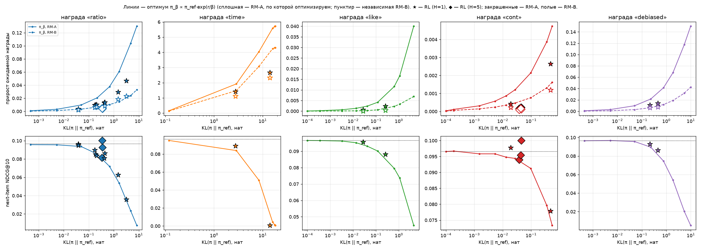
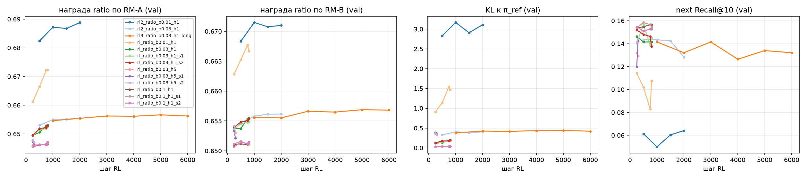
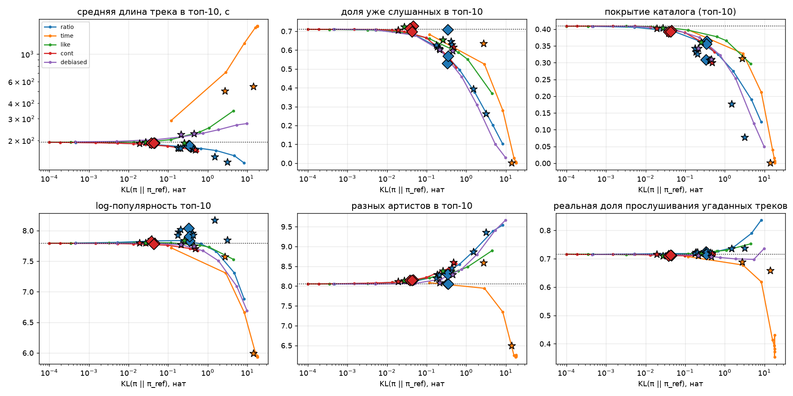
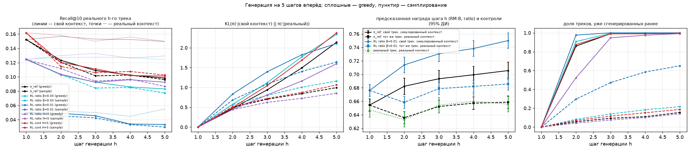

# Задание 2. RL-дообучение последовательной рекомендательной модели

> T-Lab 2026, RecSys. Код — `src/`, результаты (JSON, логи, графики) — `results/`, конспект двух статей из
> условия — `notes_papers.md`. Всё обучалось на ноутбуке без GPU (4 ядра, 16 ГБ RAM), поэтому модели маленькие.
> Каждое число в отчёте взято из файлов `results/`, производные величины (средние по сидам, сравнение с
> оптимумом, статистики данных) пересчитываются скриптами `src/summary_stats.py` и `src/data_stats.py`
> (соответствие разделов и файлов — в §9).

## Оглавление
0. [Кратко (TL;DR)](#tldr)
1. [Данные и протокол](#1)
2. [Базовая модель: GPT-2 на ID треков](#2)
3. [Reward model](#3)
4. [RL-дообучение: цель, оценка градиента, точный оптимум, многошаговый режим](#4)
5. [Метрики](#5)
6. [Результаты](#6)
7. [Ответы на исследовательские вопросы](#7)
8. [Ограничения и что дальше](#8)
9. [Воспроизведение и где лежат числа](#9)

<a id="tldr"></a>
## 0. Кратко (TL;DR)

**Что сделано**
* **Данные/протокол:** Yambda-50M (Яндекс Музыка, 46.5M прослушиваний), глобальное временное разбиение
  (test — последние сутки, 4 610 пользователей), словарь 30k треков.
* **База:** GPT-2 (HF, 2 слоя, d=64) на next-item плюс маленький repeat-head (325 параметров): next-item
  Recall@10 0.157, Recall@100 по *новым* для пользователя трекам 0.159 — в 5 раз лучше эвристики по истории
  (которая, впрочем, лучше на повторах).
* **Reward model:** каузальный трансформер по парам (трек, отклик) → доля прослушивания / лайк / продолжение
  сессии; на тесте MAE доли 0.224 (лучший простой бейзлайн 0.347), AUC «дослушает» 0.88, like AUC 0.89. Две RM
  на **непересекающихся половинах пользователей**: A — награда, B — независимый судья.
* **RL:** REINFORCE с leave-one-out бейзлайном и **точным** KL к исходной модели по всему каталогу; 5 функций
  награды, β-sweep, одношаговый и 5-шаговый режим (с симулятором отклика); 24 прогона, включая повторы по сидам.
  Для одного шага посчитан **точный оптимум** π_β ∝ π_ref·exp(r/β) — эталон для сравнения с RL.

**Главные выводы**
1. **Мягкое RL (β=0.1) почти не стоит релевантности, но и даёт мало**: next NDCG@10 статистически не меняется
   во всех 3 сидах (day-Recall в одном из трёх — значимо −0.004), покрытие каталога 0.41 → 0.39, а награда растёт
   лишь на +0.004 (RM-A) / +0.002 (RM-B) при шкале ~0.64.
2. **Дальше — reward hacking, характер которого задаёт сама награда:**
   * `ratio` (доля дослушивания) уводит в **короткие треки** и концентрирует выдачу: при β=0.01 (2000 шагов)
     средняя длина 194 → 134 с, покрытие каталога падает в 5 раз (при 800 шагах — 148 с и в 2.3 раза);
   * `time` (секунды) — в длинные объекты, при β=0.03 — **коллапс «всем один и тот же top-1»**;
   * у `like` независимая RM подтверждает лишь 9–16% прироста у RL (11–20% у π_β);
   * `cont` («продолжение сессии») при сильной оптимизации тянет к коротким трекам (194 → 168 с), вероятно,
     потому что метка считается от начала трека.
3. **RL против точного оптимума при равном KL** (сравнение корректно для одношаговых прогонов): RL получает
   31–75% (обычно 40–55%) прироста оптимума по оптимизируемой RM (18 из 18 прогонов ниже оптимума), по
   независимой — сопоставимо для `ratio/debiased` (от −23% до +29%) и меньше для остальных наград, но **теряет
   меньше релевантности** (15 из 18). KL у RL выходит на плато (≈0.42 против 0.68 у оптимума при том же β) и не
   растёт с 2000 до 6000 шагов (один прогон) — простая недообученность маловероятна.
4. **Многошаговая генерация**: контекст быстро дрейфует (у π_ref ~1 нат KL после 4 сгенерированных треков, у
   RL-политик 0.85–1.64), greedy зацикливается у всех политик. Предсказанная награда собственных роллаутов
   выше, чем у тех же треков в реальном контексте, на 0.04–0.05 (0.05–0.06 у переоптимизированной `ratio β=0.01`) —
   **разрыв возникает уже на втором шаге и у π_ref дальше не растёт**: симулированные события сдвигают оценку RM вверх, поэтому награду по симулятору нельзя
   сравнивать с реальной.
5. **Долгосрочный прокси «продолжение сессии»** слабый (AUC 0.57) и, вероятно, смещённый длиной трека; небольшое
   значимое улучшение NDCG в одном 5-шаговом прогоне **не воспроизвелось** на двух других сидах (в среднем ≈0). Офлайн такую цель
   всерьёз не проверить — нужен онлайн-эксперимент или off-policy оценка по логам.

---

<a id="1"></a>
## 1. Данные и протокол

### 1.1. Датасет
**Yambda-50M** (Яндекс Музыка, [HF `yandex/yambda`](https://huggingface.co/datasets/yandex/yambda),
`flat/50m`): 9 238 пользователей, 46.5M прослушиваний за 300 дней (в train-периоде медиана — 2 982
прослушивания на пользователя, 10-й/90-й перцентили — 248 / 12 936). У каждого прослушивания есть `played_ratio_pct` (доля
прослушанного трека), длина трека, флаг органики (`is_organic=1` — пользователь сам выбрал трек, 0 — его
включила рекомендация; 52% органики), отдельным файлом — лайки (1.1% прослушиваний получают лайк). Это ровно
сигнал из условия («доля прослушивания трека») и тот же датасет (в версии 5B), что во второй статье из условия.

Предобработка (`src/prepare.py`):
* лайк приписывается ближайшему прослушиванию того же трека тем же пользователем в окне ±10 минут, но никогда
  через границу train/val/test;
* для каждого прослушивания запоминается время до следующего прослушивания пользователя (для метки
  «продолжение сессии»).

### 1.2. Разбиение (глобальное временное)
| | train | val | test |
|---|---|---|---|
| период | всё до последних двух суток | предпоследние сутки | последние сутки |
| прослушиваний | 46.0M | 217k | 232k |
| пользователей с событиями | 9 238 | — | 4 812 |

* Все модели обучаются только на train; модели и чекпойнты выбираются по val; test — только итоговые числа.
* На val/test модель «развёрнута» в момент разбиения: видит историю пользователя до этого момента (включая
  val-день для теста), предсказывает, что он будет слушать дальше. Статистики треков, нужные на тесте
  (популярность, медианная длина), считаются по данным до начала тестового дня.
* **Словарь**: 30 000 самых популярных в train треков — 72% прослушиваний train и 68% прослушиваний test.
  Остальное — токен `UNK`: он виден во входе, но никогда не предсказывается и не рекомендуется.
* **Тестовая выборка**: 4 610 пользователей (есть история и хотя бы один трек из словаря в тестовый день);
  next-item метрики — по 3 219 пользователям, у которых *первый* трек тестового дня из словаря.

### 1.3. Особенности данных, которые определяют всё дальнейшее
* **Повторное прослушивание доминирует**: 71% прослушиваний — треки, которые пользователь уже слушал; но
  только 36.5% следующих (первых в тестовом дне) треков есть в видимом контексте из 128 последних событий.
* **Доля прослушивания бимодальна**: 54% прослушиваний — 100%, четверть — ≤7% (скип).
* **Длина трека и вовлечённость** (все прослушивания train, включая треки вне словаря; `results/data_stats.json`):

| длина трека | доля прослушиваний | средняя доля прослушивания | доля «дослушал ≥90%» | среднее прослушанное время | доля лайков |
|---|---|---|---|---|---|
| < 2 мин | 3.8% | 0.70 | 0.63 | 68 с | 0.83% |
| 2–3 мин | 28.7% | 0.68 | 0.61 | 103 с | 1.01% |
| 3–4 мин | 45.1% | 0.64 | 0.58 | 132 с | 1.10% |
| 4–5 мин | 16.0% | 0.62 | 0.55 | 160 с | 1.28% |
| 5–10 мин | 6.0% | 0.58 | 0.51 | 206 с | 1.49% |
| > 10 мин | 0.3% | 0.49 | 0.42 | 573 с | 0.51% |

  (Среди треков *из словаря* строка «> 10 мин» иная — доля прослушивания 0.63, но таких прослушиваний всего 15.5k.)

  Короткие треки дослушивают чаще, а по *секундам* длинные слушают дольше. Это заранее предсказывает, куда
  «поедет» RL с наградой за долю и с наградой за время.
* Прослушивания, включённые рекомендацией, дослушивают чаще органических (0.70 против 0.60).

<a id="2"></a>
## 2. Базовая модель: GPT-2 на ID треков

**GPT-2** (`src/train_gpt.py`): HuggingFace `GPT2LMHeadModel`, токены — ID треков; 2 слоя, d=64, 2 головы
внимания, контекст 128 событий, полный softmax по 30 002 токенам, tied embeddings — 2.03M параметров.
Обучение — next-item prediction (cross-entropy на всех позициях, таргеты `PAD/UNK` игнорируются) на окнах из
129 подряд идущих событий train-периода; пользователи сэмплируются пропорционально длине истории.
AdamW, lr 2e-3, weight decay 0.01, dropout 0.1, 100 шагов прогрева + косинусное затухание до 10% пикового lr,
3000 шагов × 64 окна (≈24M токенов, около половины эпохи). Чекпойнт выбирается по val NDCG@10.

| шаг | train CE | val next R@10 | val next R@100 | val R@100 по новым трекам |
|---|---|---|---|---|
| 500 | 8.53 | 0.050 | 0.184 | 0.127 |
| 1500 | 7.76 | 0.084 | 0.276 | 0.186 |
| 3000 | 7.57 | 0.103 | 0.294 | 0.196 |

**Repeat-head** (`src/common.py:RepeatHead`, `src/train_repeat.py`). Маленькая модель с d=64 не может точно
«держать» в одном векторе множество из сотни треков контекста и плохо выучивает повторное прослушивание, хотя
оно доминирует в музыке; простая эвристика «частые недавние треки пользователя» её обгоняет (§6.1). Поэтому
поверх GPT-2 добавлен repeat-aware выход в духе RepeatNet: для трека `a`, который уже есть в контексте,
к логиту добавляется

`w(h) · [a присутствует, a — последний трек, Σ_occ e^{−age/4}, Σ_occ e^{−age/32}, Σ_occ e^{−age/128}]`,

где `age` — сколько событий назад было вхождение, `w(h)` — линейная функция состояния GPT. 325 параметров,
инициализация нулём (стартуем ровно с GPT-2, это проверено), GPT заморожен; обучение на последней позиции
окна, 400 шагов × 2048 таргетов, Adam lr 1e-2, чекпойнт по val NDCG@10. **Эта модель (GPT-2 + repeat-head)
и есть исходная политика π_ref для всех RL-экспериментов.**

<a id="3"></a>
## 3. Reward model

`src/train_rm.py`. Отдельный каузальный трансформер (GPT-2 backbone, 2 слоя, d=64) читает историю как пары
*(трек, отклик)*: вход позиции — `emb(трек) + emb(бакет доли прослушивания: 5 бакетов) + emb(лайк) +
emb(органика)`. По состоянию после `t` событий и кандидату — `emb(трек) + Linear([log-длина, флаг органики])` —
MLP (вход `[h, c, h⊙c]`, 2 скрытых слоя по 128) предсказывает три отклика на кандидата:
* `ratio` — долю прослушивания (BCE с мягкой меткой ∈ [0, 1]);
* `like` — будет ли лайк (BCE);
* `cont` — **продолжится ли сессия** после трека: следующее прослушивание начнётся не позже чем через 30 минут
  после *начала* этого (BCE) — прокси для долгосрочной цели.

Лосс: `BCE_ratio + BCE_like + 0.5·BCE_cont`; таргеты `UNK` игнорируются; метка `cont` маскируется, если её
нельзя было наблюдать до границы train (событие ближе 30 минут к границе). Обучение — 4000 шагов × 64 окна по
128 событий, AdamW lr 2e-3, dropout 0.1, косинус до 10% пикового lr; чекпойнт — по val
(минимум `MAE − 0.1·AUC_like − 0.1·AUC_cont`).

Обучаются **две** RM на **непересекающихся половинах пользователей** (фиксированная перестановка,
`--user_half 0/1`): **RM-A** — награда при RL, **RM-B** — только независимый «судья» для измерения
переоптимизации. У RM нет ID пользователей (только история), поэтому они применимы к любому пользователю.

Для оценки политик нужна награда за *любой* трек каталога: `RMScorer.score_all` считает предсказания RM для всех
30k треков сразу, раскладывая первый слой MLP на «часть от состояния» + «часть от трека» + «произведение»
(математически эквивалентно `rm.head`, проверено код-ревью).

<a id="4"></a>
## 4. RL-дообучение

`src/rl.py`. Состояния — случайные префиксы историй пользователей из train-периода (как при обучении GPT).

### 4.1. Цель
`J(θ) = E_{a~π_θ}[ Σ_h γ^h r(s_h, a_h) ] − β · Σ_h KL(π_θ(·|s_h) ‖ π_ref(·|s_h))`, γ = 1.

* **Награда** `r(s, a)` — функция предсказаний RM-A для трека `a` в состоянии `s` (таблица ниже).
* **Градиент награды** — REINFORCE с **leave-one-out бейзлайном** (RLOO): для каждого состояния сэмплируется
  G треков из текущей политики, бейзлайн каждого — средняя награда остальных G−1. Без нормировки на std,
  чтобы β сохранял смысл «температуры» исходной цели.
* **KL к π_ref считается точно, по всему каталогу** (30k действий — это дёшево), а не по сэмплам; градиент KL —
  точный.
* Dropout отключён: сэмплирование и градиент идут из одной и той же политики (строго on-policy).

### 4.2. Точный оптимум для одного шага
Для H=1 оптимум цели известен в закрытой форме: `π*_β(a|s) ∝ π_ref(a|s) · exp(r(s,a)/β)`. Поскольку RM можно
посчитать для всех 30k треков, мы считаем π*_β **точно** для каждого тестового пользователя (`src/analysis.py`).
Это даёт:
1. всю кривую «награда ↔ релевантность» по β без RL-шума;
2. эталон, с которым сравнивается то, что выучил RL;
3. ответ на вопрос «зачем RL, если можно переранжировать по RM»: π*_β требует RM на инференсе для *всех*
   кандидатов, а RL «вшивает» её в саму политику; кроме того, для многошаговых целей закрытой формы нет.

### 4.3. Многошаговый режим (H=5)
Сгенерированные треки добавляются в контекст политики (только ID). Чтобы оценить следующий шаг, RM-A нужен
отклик пользователя на сгенерированные треки — он **симулируется** самой RM-A: трек «дослушан» с вероятностью
предсказанного `ratio`, иначе «скип»; лайк — с вероятностью `p_like`. Градиент — reward-to-go, в который входят
и KL-штрафы будущих состояний (без этого градиент для H>1 смещён: действие на шаге h влияет на то, в каких
состояниях будет считаться KL дальше — это нашло код-ревью и исправлено до финальных прогонов).

### 4.4. Функции награды (`src/rewards.py`, все поверх RM-A)
| имя | формула | что поощряет |
|---|---|---|
| `ratio` | p_ratio | дослушивание (краткосрочная вовлечённость) |
| `time` | p_ratio · длина / 200 с | ожидаемые секунды прослушивания |
| `like` | p_like + 0.1·p_ratio | вид награды из второй статьи условия |
| `cont` | p_cont | продолжение сессии (долгосрочный прокси) |
| `debiased` | p_ratio − E[ratio \| длина трека] | дослушивание сверх ожидаемого для такой длины (E — по 20 квантилям длины в train) |

### 4.5. Конфигурации прогонов
| серия | H | состояний × сэмплов G | шаги | Adam lr | прогоны |
|---|---|---|---|---|---|
| 1 | 1 | 32 × 16 | 800 | 3e-4 | `ratio` β∈{0.1, 0.03, 0.01}; `time/like/cont/debiased` β=0.03 |
| 2 (KL-согласованные β, длиннее) | 1 | 32 × 16 | 2000 | 1e-3 | `ratio` β∈{0.03, 0.01}; `time` 0.5; `like` 0.012; `cont` 0.004; `debiased` 0.03 |
| многошаговая | 5 | 16 × 8 | 300 | 3e-4 | `ratio`, `cont` β=0.03 |
| повторы по сидам | 1 / 5 | как выше | как выше | как выше | `ratio` β=0.1 и 0.03 (H=1), `ratio` и `cont` β=0.03 (H=5): сиды 1, 2 |
| длинный прогон | 1 | 32 × 16 | 6000 | 1e-3 | `ratio` β=0.03 — «недообученность или ёмкость?» |

β для `like`, `cont`, `debiased` и `ratio` β=0.03 в серии 2 подобраны по кривым точного оптимума так, чтобы
KL(π*‖π_ref) был ~0.5–0.8 нат (0.63 / 0.55 / 0.77 / 0.68): шкалы наград сильно различаются, и один β для всех
даёт несопоставимую силу оптимизации. Для `time` β=0.5 даёт KL(π*) = 2.9 (KL при меньших β растёт очень резко), а
`ratio` β=0.01 (KL(π*) = 4.7) — намеренно сильная оптимизация.

<a id="5"></a>
## 5. Метрики

Все политики оцениваются одним протоколом (`src/analysis.py:TestBed`, `src/eval_policies.py`) на 4 610 тестовых
пользователях в момент начала тестового дня.

* **Релевантность**: next-item Recall@K / NDCG@K (первый трек дня; 3 219 пользователей), day Recall@K / NDCG@K
  (все треки из словаря, прослушанные за день), Recall@100 по *новым* для пользователя трекам.
* **Награда** — *точное* ожидание `Σ_a π(a|s)·r(s,a)` по всему каталогу под RM-A и под RM-B (для всех 5 видов
  награды сразу), а также средняя награда топ-10.
* **Поведение**: KL(π‖π_ref) и энтропия; coverage@10 (доля каталога, попавшая хоть в чей-то топ-10), Gini и
  энтропия распределения рекомендаций, доля пользователей с самым частым top-1 треком («всем одно и то же»),
  средняя log-популярность, средняя длина трека, доля уже слушанных треков в топ-10, число разных артистов в
  топ-10 (по `artist_item_mapping`).
* **Реальные отклики**: для треков из топ-10, которые пользователь *действительно* послушал в тестовый день, —
  их фактическая доля прослушивания и доля лайков (сколько таких совпадений и насколько они «хорошие»).
* **Значимость**: 95% ДИ изменения next NDCG@10 и day Recall@10 относительно π_ref — парный бутстрап по
  пользователям (2000 повторов, `src/significance.py`), без поправки на множественные сравнения. Эти ДИ отражают
  только случайность выборки тестовых пользователей, но не разброс между сидами RL (он оценён отдельно, §6.5).

<a id="6"></a>
## 6. Результаты

### 6.1. Базовая модель (test: 4 610 пользователей, next-метрики — 3 219)

| модель | next R@10 | next NDCG@10 | next R@100 | day R@10 | day NDCG@10 | R@100 по *новым* трекам | coverage@10 | доля повторов в топ-10 |
|---|---|---|---|---|---|---|---|---|
| популярное за последний день | 0.030 | 0.015 | 0.104 | 0.034 | 0.035 | 0.082 | 0.0003 | 0.07 |
| эвристика «частые недавние треки» | **0.216** | **0.134** | **0.381** | **0.207** | **0.212** | 0.031 | 0.58 | 0.99 |
| GPT-2 | 0.107 | 0.065 | 0.284 | 0.107 | 0.110 | **0.175** | 0.34 | 0.29 |
| GPT-2 + repeat-head (**π_ref**) | 0.157 | 0.097 | 0.352 | 0.157 | 0.162 | 0.159 | 0.41 | 0.71 |

* Repeat-head (325 параметров) поднимает next-item Recall@10 с 0.107 до 0.157 и Recall@100 с 0.284 до 0.352
  ценой небольшой потери в новых треках (0.175 → 0.159).
* Эвристика по истории всё ещё выше на top-10: она идеально «вспоминает» уже слушанное, но почти не умеет
  новое (Recall@100 по новым трекам 0.03 против 0.16 у модели). Модель обучена на правдоподобие (CE), и для неё
  оптимально делить вероятность между повтором и открытием; Recall@10 же выгоднее «перекосить» в повторы
  (в предварительном прогоне головы val Recall@10 сначала рос, а потом падал: 0.153 → 0.136 → 0.127, хотя CE
  продолжал снижаться 7.363 → 7.319; `results/old/gptrep_b256.json`).
  Для RL важна именно *калиброванная* политика: от неё считается KL и из неё сэмплируются действия.

### 6.2. Reward model (test: 157k прослушиваний последнего дня с треками из словаря)

| | MAE доли | RMSE | Spearman | AUC «дослушал ≥90%» | AUC «скип <30%» | like ROC-AUC | like AP (база 1.05%) | AUC «сессия продолжится» |
|---|---|---|---|---|---|---|---|---|
| среднее по всем | 0.407 | — | — | 0.5 | — | — | — | — |
| среднее по треку | 0.415 | — | — | 0.557 | — | — | — | — |
| среднее по пользователю | 0.347 | — | — | 0.710 | — | — | — | — |
| **RM-A** (половина пользователей) | **0.224** | 0.312 | 0.643 | **0.883** | 0.882 | **0.894** | **0.152** | 0.573 |
| **RM-B** (другая половина) | 0.233 | 0.317 | 0.627 | 0.874 | 0.876 | 0.890 | 0.150 | 0.572 |

Для ориентира: во второй статье из условия (Yambda-5B, модель 4×256, другой горизонт) MAE доли 0.177 и like
PR-AUC 0.243 — порядок величин тот же, но данные и постановка разные, поэтому прямое сравнение некорректно. Голова `cont` слабая (AUC 0.57): когда человек закончит
слушать, по истории прослушиваний предсказывается плохо.

### 6.3. Компромисс «награда ↔ релевантность»: точный оптимум π_β

Для всех 4 610 тестовых пользователей π*_β посчитан точно при 8–9 значениях β для каждой из 5 наград
(`results/tilting.json`).



*Рисунок: верхний ряд — прирост ожидаемой награды по RM-A (сплошная, её оптимизируем) и RM-B (пунктир,
независимый судья) как функция KL(π‖π_ref); нижний ряд — next NDCG@10. Линии — точный оптимум π_β, звёзды —
RL-политики (H=1), ромбы — RL с H=5 (для них по оси — одношаговые величины, см. §6.4); у RL-точек закрашенный
маркер — RM-A, полый — RM-B.*

Кривая для основной награды `ratio` (доля прослушивания):

| β | KL(π‖π_ref) | Δ награды, RM-A | Δ награды, RM-B (судья) | next NDCG@10 | next R@10 | coverage@10 | доля повторов | ср. длина трека |
|---|---|---|---|---|---|---|---|---|
| π_ref | 0 | — | — | 0.0965 | 0.157 | 0.41 | 0.71 | 194 с |
| 0.1 | 0.05 | +0.010 | +0.003 | 0.0937 | 0.153 | 0.39 | 0.68 | 185 с |
| 0.05 | 0.21 | +0.021 | +0.006 | 0.0856 | 0.138 | 0.37 | 0.61 | 178 с |
| 0.03 | 0.68 | +0.038 | +0.010 | 0.0719 | 0.118 | 0.32 | 0.50 | 172 с |
| 0.01 | 4.73 | +0.104 | +0.024 | 0.0235 | 0.041 | 0.19 | 0.20 | 150 с |

* Награда по RM-A растёт быстро, по независимой RM-B — в 3–4 раза медленнее: значительная часть «прироста» —
  переоптимизация под ошибки конкретной reward model (с оговоркой, что RM-B — тоже модель, см. §8).
* Релевантность падает монотонно, всё быстрее при KL > 1; при KL ≈ 0.7 нат теряется четверть NDCG@10.
* Для остальных наград кривые устроены так же, но масштабы β совершенно разные: у `time` уже β=0.3 даёт
  KL 8.4 нат, а у `cont` даже β=0.005 — лишь 0.36 нат.

### 6.4. RL-дообучение: основная таблица (test)

ΔR — прирост *точной* ожидаемой одношаговой награды той функции, которую оптимизировали; ΔNDCG — изменение
next NDCG@10 относительно π_ref с 95% ДИ парного бутстрапа (`results/policies_eval.json`,
`results/significance.json`).

| политика | шаги | KL | ΔR (RM-A) | ΔR (RM-B) | ΔNDCG@10 [95% ДИ] | next R@10 | cov@10 | повторы | длина | top-1 у одного трека |
|---|---|---|---|---|---|---|---|---|---|---|
| π_ref | — | 0 | — | — | — | 0.157 | 0.41 | 0.71 | 194 с | 1.4% |
| ratio, β=0.1 | 800 | 0.04 | +0.004 | +0.002 | **−0.0003 [−0.003, +0.002]** | 0.158 | 0.39 | 0.72 | 185 с | 2.0% |
| ratio, β=0.03 | 800 | 0.18 | +0.010 | +0.007 | −0.011 [−0.015, −0.008] | 0.139 | 0.33 | 0.62 | 173 с | 2.7% |
| ratio, β=0.03 | 2000 | 0.41 | +0.013 | +0.008 | −0.016 [−0.020, −0.010] | 0.130 | 0.31 | 0.65 | 170 с | 3.0% |
| ratio, β=0.03 | 6000 | 0.43 | +0.014 | +0.008 | −0.010 [−0.015, −0.006] | 0.140 | 0.31 | 0.63 | 170 с | 3.9% |
| ratio, β=0.01 | 800 | 1.50 | +0.029 | +0.018 | −0.034 [−0.040, −0.028] | 0.106 | 0.18 | 0.39 | 148 с | 11.5% |
| ratio, β=0.01 | 2000 | 3.17 | +0.047 | +0.023 | −0.061 [−0.068, −0.053] | 0.057 | **0.08** | 0.26 | **134 с** | 8.3% |
| time, β=0.03 | 800 | 14.1 | +2.67 | +2.32 | −0.096 | 0.001 | **0.0008** | 0.00 | **547 с** | **100%** |
| time, β=0.5 | 2000 | 2.75 | +1.43 | +1.11 | −0.008 [−0.012, −0.003] | 0.152 | 0.31 | 0.64 | 502 с | 25% |
| like, β=0.03 | 800 | 0.03 | +0.001 | +0.0001 | −0.001 [−0.003, +0.001] | 0.157 | 0.40 | 0.72 | 193 с | 1.7% |
| like, β=0.012 | 2000 | 0.25 | +0.002 | +0.0004 | −0.008 [−0.013, −0.004] | 0.145 | 0.36 | 0.65 | 191 с | 4.4% |
| cont, β=0.03 | 800 | 0.02 | +0.0004 | +0.0002 | +0.001 [−0.001, +0.003] | 0.158 | 0.40 | 0.71 | 189 с | 1.1% |
| cont, β=0.004 | 2000 | 0.48 | +0.003 | +0.001 | −0.019 [−0.023, −0.014] | 0.124 | 0.30 | 0.62 | 168 с | 1.2% |
| debiased, β=0.03 | 800 | 0.21 | +0.011 | +0.006 | −0.004 [−0.007, +0.0004] | 0.151 | 0.34 | 0.60 | 224 с | 1.3% |
| debiased, β=0.03 | 2000 | 0.45 | +0.014 | +0.008 | −0.010 [−0.015, −0.006] | 0.136 | 0.31 | 0.60 | 227 с | 1.3% |
| ratio, **H=5**, β=0.03 | 300 | 0.33 | +0.005* | +0.005* | −0.015 [−0.020, −0.010] | 0.131 | 0.31 | 0.53 | 182 с | 2.5% |
| cont, **H=5**, β=0.03 | 300 | 0.05 | +0.0002* | +0.0001* | +0.0035 [+0.001, +0.006] | 0.165 | 0.40 | 0.73 | 190 с | 1.0% |

KL — среднее по тестовым пользователям на первом шаге. \*Для H=5 оптимизировался 5-шаговый возврат, поэтому
одношаговый ΔR с H=1 напрямую не сравним. Для `time β=0.03` ДИ не считался (коллапс очевиден). В таблице —
сид 0; повторы по сидам — в §6.5.

**Отношение приростов «судья / оптимизируемая RM»** зависит от награды: для `ratio`/`debiased`/`cont` (H=1)
RM-B подтверждает 45–67% прироста RM-A (у точного оптимума π_β при KL, сопоставимом с RL-прогонами, — 24–35% для
`ratio`/`debiased`, 34–40% для `cont`), для `like` — 9–16% у RL (11–20% у π_β), для `time` — ~78–87% (обе RM согласны, см. §6.7), для `ratio`
с H=5 — ≈100%.

### 6.5. Воспроизводимость: повторы по сидам

Ключевые конфигурации повторены с сидами 1 и 2 (`results/significance_seeds.json`):

| конфигурация | KL (сиды 0/1/2) | ΔR RM-A / RM-B (среднее ± sd) | ΔNDCG@10 по сидам [значимо?] | вывод |
|---|---|---|---|---|
| ratio, β=0.1, H=1 | 0.038 / 0.038 / 0.038 | +0.0037 ± 0.0000 / +0.0024 ± 0.0000 | −0.0003, −0.0004, −0.0017 (все незначимы) | воспроизводится; но day-Recall в сиде 2 значимо −0.004 |
| ratio, β=0.03, H=1 | 0.184 / 0.175 / 0.206 | +0.0099 ± 0.0005 / +0.0065 ± 0.0004 | −0.011, −0.007, −0.013 (все значимы) | воспроизводится |
| **cont, β=0.03, H=5** | 0.045 / 0.038 / 0.043 | +0.0002 / +0.0001 | **+0.0035 (значимо), −0.0026 (значимо), −0.0011 (незначимо)** | **«улучшение» сида 0 не воспроизводится** |
| ratio, β=0.03, H=5 | 0.33 / 0.35 / 0.35 | +0.0044 ± 0.0005 / +0.0043 ± 0.0005 | −0.015, −0.004, +0.004 | большой разброс между сидами |

* Одношаговые RL-прогоны стабильны: при β=0.1 KL, приросты наград и сдвиг длины (185 с) совпадают между сидами
  до третьего знака; при β=0.03 KL различается между сидами на 16% от среднего (0.175–0.206), ΔR_A — на 9.5%
  (0.0095–0.0104), длина 172–175 с, sd сдвига NDCG ≈0.003 (sd выборочное, ddof=1; `results/summary_stats.json`).
* Пятишаговые прогоны (300 шагов, маленький батч) шумные: NDCG между сидами различается на 0.019, доля повторов —
  от 0.53 до 0.71. Единичный пятишаговый прогон нельзя интерпретировать.
* **Небольшое значимое улучшение NDCG от `cont` при H=5 в сиде 0 не воспроизвелось**: в сиде 1 изменение
  значимо *отрицательное*, в сиде 2 — незначимое; в среднем NDCG 0.0965 ± 0.0032 — ровно как у π_ref, а
  day-Recall в сидах 1 и 2 значимо ниже π_ref (−0.004 и −0.0035), хотя в сиде 0 он был значимо выше
  (+0.0029 [+0.0008; +0.0049]) — это тоже не воспроизвелось. Бутстрап-ДИ отражают только выборку
  пользователей, поэтому единичный «значимый» RL-прогон без повторов по сидам — слабое доказательство.

### 6.6. RL против точного оптимума и «недообученность vs ёмкость»

π_β — точный оптимум только для одношаговой цели, поэтому корректное сравнение — для 18 прогонов с H=1.
Кривая π_β (для каждой награды, эталон π_ref при KL=0) интерполируется по log KL к KL каждого RL-прогона
(`src/summary_stats.py` → `results/summary_stats.json`):
* по оптимизируемой RM-A RL получает **меньше** π_β во **всех 18** прогонах: 31–75% (обычно 40–55%) прироста
  оптимума;
* по независимой RM-B RL не хуже π_β в **5 из 18**: для `ratio`/`debiased` RL сопоставим с оптимумом (от −23% до
  +29%), для `time` — на 24–42% меньше, для `like`/`cont` — на 22–77% меньше;
* NDCG@10 у RL **выше**, чем у π_β с тем же KL, в **15 из 18** (например, `ratio` при KL≈1.5: 0.063 против
  ≈0.056); исключения — два из трёх сидов `ratio β=0.03` (800 шагов, разница ≤0.0021) и коллапсировавший
  `time β=0.03`;
* при линейной (а не логарифмической) интерполяции счёт немного меняется: 18/18, 6/18 и 14/18;
* H=5-прогоны оптимизировали 5-шаговый возврат: их одношаговый прирост RM-A — лишь 11–18% от π_β, по RM-B они
  на 39–84% ниже π_β, и «более высокая NDCG» (6 из 6) там тривиальна — одношаговая награда почти не выросла.

То есть при равном «отклонении» от исходной модели одношаговый RL тратит его менее «жадно» на эксплуатацию RM-A
и теряет меньше релевантности; по судье для `ratio/debiased` он сопоставим с оптимумом, для остальных наград —
заметно хуже.

**Недообученность или ёмкость?** Прогон `ratio β=0.03` удлинён до 6000 шагов (lr 1e-3): KL выходит на плато
≈0.42 уже к шагу 2000 и дальше не растёт (0.38 → 0.42 → 0.42 → 0.44 → 0.44 → 0.42 на шагах 1000…6000), тогда как
у точного оптимума при том же β KL = 0.68 (KL по шагам — на подвыборке 1 500 val-пользователей из лога
обучения; на тесте у 6000-шагового прогона KL 0.43). На тесте 2000-шаговый (отдельный прогон серии 2) и
6000-шаговый прогоны почти не отличаются: ΔR_A +0.013 → +0.014, ΔR_B +0.008 → +0.008.



*Рисунок: кривые обучения прогонов с наградой `ratio` (подвыборка 1 500 val-пользователей): награда по RM-A и
RM-B, KL к π_ref и next Recall@10 по шагам.*

Значит, дело не в числе шагов: параметрическая политика сходится к точке заметно ближе к π_ref, чем точный
оптимум. Вероятные причины — одна сеть на всех пользователей (не может повторить «точечный» наклон
распределения для каждого состояния) и шум градиента по сэмплам; разделить их окончательно можно абляцией по
размеру модели и размеру батча (не делалась).

### 6.7. Как меняется поведение и откуда берётся «рост награды»



*Рисунок: поведенческие метрики топ-10 как функция KL; линии — точный оптимум π_β, звёзды/ромбы — RL.*

* **`ratio` → короткие треки.** Средняя длина рекомендаций падает с 194 до 134–148 с у RL (150 с у π_β при
  β=0.01): в данных короткие треки дослушивают чаще (§1.3), и RM это выучила. Это тот hack, о котором
  предупреждает условие: доля дослушивания растёт, а ожидаемое прослушанное *время* под RM-B падает — на 2.4%
  при β=0.1 и на 25% при β=0.01 (2000 шагов).
* **`time` → очень длинные объекты и полный коллапс.** Максимизация ожидаемых секунд при β=0.03 приводит к
  коллапсу примерно к 450-му шагу RL (энтропия политики падает почти до нуля), и к концу обучения **всем
  пользователям** первым рекомендуется один и тот же объект (top-1 share 100%, покрытие каталога 0.08%),
  средняя длина 547 с (у π_β — до 1690 с). Обе RM *согласны*, что слушать будут дольше (+2.3 по RM-B), —
  это не ошибка RM, а **неверно поставленная цель**.
* **`like` — в основном переоптимизация.** Прирост по RM-B — лишь 9–16% от прироста по RM-A у RL (11–20% у π_β): лайк редкий
  (1%), его предсказание шумное, и политика находит шум конкретной модели. π_β уходит в более длинные треки
  (лайкают чаще треки 5–10 мин), а RL-политики длину почти не меняют.
* **`cont` (продолжение сессии) при сильной оптимизации тянет к коротким трекам**: 189 с при β=0.03 (−2.5%),
  168 с при β=0.004. Вероятная причина — разрыв считается от *начала* трека до начала следующего, поэтому после
  короткого трека следующее событие наступает раньше (в train доля «продолжения» падает с длиной: 0.953 для
  треков < 2 мин, 0.939 для 5–10 мин, 0.79 для > 10 мин; `results/data_stats.json` → `length_table.cont`); голова `cont` к тому же слабая (AUC 0.57). Прокси
  «долгосрочной» цели, по-видимому, загрязнён длиной трека.
* **`debiased` убирает «короткий» hack, но перекручивает в длинные** (224–227 с у RL, 229 с у π_β при β=0.03);
  вероятная причина — вычитается среднее по популяции, а RM учит индивидуальные эффекты длины.
* **Повторы.** Оптимизация `ratio` *уменьшает* долю уже слушанных треков в топ-10: при β=0.1 она не меняется
  (0.71–0.72), при β=0.03 — 0.61–0.65, при β=0.01 — 0.26–0.39. Видимо, по мнению RM «новые короткие» треки
  дослушают лучше повторов, — при этом число треков из топ-10, которые пользователь реально послушал в тот день,
  падает (5 818 у π_ref → 2 286 у `ratio β=0.01`, 2000 шагов).
* **«Всем одно и то же».** Для `ratio`/`cont`/`debiased` при KL ≲ 0.5 доля пользователей с самым частым top-1
  ≤ 4%. Сильная оптимизация `ratio` (β=0.01) концентрирует выдачу: покрытие каталога падает в 5 раз
  (0.41 → 0.08), Gini растёт с 0.57 до 0.84, top-1 share 8–11.5%. У `time` уже при β=0.5 (KL 2.75) у 25%
  пользователей один и тот же top-1, а при β=0.03 — полный коллапс (100%).
* **Реальные отклики.** Среди треков из топ-10, которые пользователь *действительно* послушал в тестовый день,
  фактическая доля прослушивания растёт с оптимизацией `ratio` (0.716 → 0.737 у RL, до 0.79 у π_β при
  β=0.01). Это согласуется с тем, что RM указывает верное направление, но оценка смещена отбором: совпадений
  становится в 1.5–2.5 раза меньше у RL (в 3.3 раза у π_β при β=0.01), и это другое, отобранное подмножество треков (ДИ не считались).

### 6.8. Генерация на несколько шагов вперёд

`src/multistep.py`: 2 000 тестовых пользователей с ≥5 прослушиваниями в тестовый день. На шаге h политика видит
либо *свои* h−1 сгенерированных трека, либо *реальные* h−1 прослушивания пользователя. Чтобы оценить награду
сгенерированного трека, каждая RM (A и B) получает свой контекст с откликом на предыдущие сгенерированные
треки, симулированным ею самой. **Контроли** (добавлены после код-ревью):
* *тот же* сгенерированный трек, но оценённый RM в *реальном* контексте (реальные h−1 прослушиваний с
  реальными откликами);
* *реальный* h-й трек пользователя в реальном контексте;
* фактическая доля прослушивания реального h-го трека.

Для всех величин посчитаны стандартные ошибки по пользователям (на графике — 95% ДИ).



| (сэмплирование) | R@10 реального h-го трека, свой контекст (h=1→5) | то же, реальный контекст | KL(свой ‖ реальный) на h=5 | доля самоповторов на h=5 |
|---|---|---|---|---|
| π_ref | 0.152 → 0.096 | 0.152 → 0.150 | 0.99 | 16% |
| RL ratio β=0.03 (H=1, 2000 шагов) | 0.125 → 0.077 | 0.125 → 0.124 | 1.16 | 22% |
| RL ratio β=0.01 (H=1, 2000 шагов) | 0.050 → 0.030 | 0.050 → 0.055 | 1.64 | 65% |
| RL ratio β=0.03 (H=5), сид 0 / сид 1 | 0.124 → 0.087 / 0.145 → 0.089 | 0.124 → 0.129 / 0.145 → 0.136 | 0.85 / 1.36 | 14% / 22% |
| RL cont β=0.03 (H=5), сид 0 / сид 1 | 0.162 → 0.103 / 0.151 → 0.094 | 0.162 → 0.150 / 0.151 → 0.150 | 1.07 / 1.02 | 19% / 16% |

Предсказанная награда (`ratio`, RM-B) по шагам h = 1, 2, 3, 4, 5 и контроли (сэмплирование):

| | h=1 | h=2 | h=3 | h=4 | h=5 |
|---|---|---|---|---|---|
| π_ref: свой трек, **симулированный** контекст | 0.654 | 0.682 | 0.693 | 0.699 | 0.706 |
| π_ref: **тот же** трек, **реальный** контекст | 0.654 | 0.636 | 0.652 | 0.657 | 0.659 |
| **разрыв** (симулированный − реальный) | 0 | **0.047** | **0.041** | **0.042** | **0.047** |
| π_ref: реальный трек пользователя, реальный контекст | 0.647 | 0.633 | 0.654 | 0.660 | 0.656 |
| фактическая доля прослушивания реального трека | 0.594 | 0.694 | 0.704 | 0.704 | 0.706 |
| RL ratio β=0.01: свой трек, симулированный контекст | 0.676 | 0.714 | 0.730 | 0.738 | 0.750 |
| RL ratio β=0.01: тот же трек, реальный контекст | 0.676 | 0.658 | 0.679 | 0.682 | 0.686 |
| **разрыв** | 0 | 0.056 | 0.052 | 0.056 | 0.064 |

(стандартная ошибка каждого значения ≈0.005–0.006; на шаге 1 контекст один и тот же, поэтому разрыв = 0; разрыв
посчитан по неокруглённым значениям, поэтому может отличаться от разности округлённых на 0.001.)

* **Дрейф контекста.** Уже после первого сгенерированного трека распределение следующего шага отличается от
  предсказанного по реальной истории на ~0.5 нат, дальше — ещё по ~0.15–0.2 нат за шаг (у π_ref, сэмплирование; у
  `ratio β=0.01` — 0.68 нат и затем +0.24…+0.40 за шаг; в
  greedy — 1.6–2.7 нат к 5-му шагу, у π_ref 2.14). Точность предсказания реального h-го трека падает на 30–40% к
  5-му шагу, хотя на реальном контексте она не меняется.
* **Greedy-генерация зацикливается у всех политик**: к 3-му шагу 95–100% сгенерированных треков уже были
  сгенерированы раньше. Вероятный механизм — сгенерированный трек попадает в контекст и получает бонус
  repeat-head (петля положительной обратной связи); отдельно это не проверялось. Сэмплирование снижает долю самоповторов до 14–22% у умеренных политик (у
  сильно переоптимизированной `ratio β=0.01` — до 65%).
* **Симулированный контекст завышает оценку награды.** Предсказанная награда собственных роллаутов при
  сэмплировании растёт за 5 шагов на +0.05…+0.08 (greedy +0.04…+0.07) у всех политик и у обеих RM, а те же треки
  в реальном контексте — лишь на +0.004…+0.012. Но контроль по шагам показывает, что это **сдвиг уровня, а не
  накопление**: разрыв между симулированным и реальным контекстом возникает уже на втором шаге и у π_ref
  дальше не растёт (0.041–0.047 на шагах 2–5; от h=2 до h=5 награда растёт одинаково в обоих контекстах: +0.023
  и +0.023). У сильно переоптимизированной `ratio β=0.01` разрыв больше и немного растёт (0.056 → 0.064: +0.036 в
  симулированном контексте против +0.027 в реальном), но и там основная часть разрыва возникает сразу. Правдоподобное объяснение — симулированные события отличаются от реальных: все
  они помечены как «включённые рекомендацией» (organic=0), а такие прослушивания в данных дослушивают чаще
  (0.70 против 0.60), и отклик у них бинарный (1.0 / 0.05). Вывод: награду, посчитанную по симулятору, нельзя
  сравнивать с реальной или одношаговой — она систематически выше. (Попутно: первый трек дня реальные
  пользователи дослушивают заметно хуже — 0.59 против ~0.70 дальше, а RM этого не улавливает.)
* **H=5-обучение и exposure bias.** В сиде 0 политика, обученная на своих 5-шаговых роллаутах с наградой `ratio`,
  дрейфовала меньше всех (KL 0.85 против 0.99 у π_ref), но в сиде 1 — больше (1.36); у H=5 с `cont` эффекта нет
  ни в одном из двух проанализированных сидов (0 и 1; сид 2 в многошаговом анализе не участвовал). **Утверждать, что H=5-обучение уменьшает дрейф, наши данные не позволяют.**

<a id="7"></a>
## 7. Ответы на исследовательские вопросы

**1. Как меняется поведение модели после RL? Удаётся ли максимизировать награду? Чем рекомендации
отличаются и почему?**
Да, RL монотонно увеличивает ожидаемую награду оптимизируемой RM, а сила изменений определяется β, масштабом
награды и длительностью обучения: при одном и том же β=0.03 `time` даёт KL 14 нат, `like` — 0.03. Подтверждаемая
независимой RM-B доля прироста зависит от награды: 45–67% для `ratio/debiased/cont`, 9–16% для `like`,
~78–87% для `time` (там «выигрыш», по-видимому, реален, но сама цель поставлена неверно). Рекомендации меняются предсказуемо
по структуре награды, и каждый сдвиг объясняется статистикой данных (§1.3) и ошибками RM:
* `ratio` → короче треки, меньше повторов, концентрация на меньшем числе треков;
* `time` → длинные объекты вплоть до коллапса;
* `like` → почти ничего реального (по судье);
* `cont` → короче (при сильной оптимизации);
* `debiased` → длиннее.

**2. Сохраняется ли релевантность? Не рекомендует ли модель всем одно и то же?**
При мягкой регуляризации (β=0.1, KL≈0.04) next NDCG@10 статистически не меняется ни в одном из трёх сидов,
day-Recall — в двух из трёх (в третьем −0.004). Но и выигрыш в награде маленький (+0.004 при шкале ~0.64), а
покрытие каталога слегка падает (0.41 → 0.39). Дальше релевантность падает монотонно и всё быстрее при KL > 1,
но сила падения зависит от награды: при KL ≈ 0.4–0.5 NDCG падает на 11–19% (`ratio`, `debiased`, `cont`), у
`ratio` при KL ≈ 3 — на 63%, а у `time` при KL 2.75 — лишь на 8% (награда за время сдвигает в основном «хвост»
распределения к длинным объектам). Сильная оптимизация концентрирует выдачу:
* `ratio` β=0.01 — покрытие каталога падает в 5 раз, Gini растёт с 0.57 до 0.84, у 8–11.5% пользователей один и
  тот же top-1;
* `time` β=0.5 — у 25% пользователей один и тот же top-1; `time` β=0.03 — полный коллапс (100%).

**3. Можно ли приблизиться к долгосрочным целям?**
Мы попробовали «продолжение сессии» (`cont`, следующее прослушивание в течение 30 минут). Сигнал в данных есть,
но:
* он плохо предсказуем (AUC 0.57);
* вероятно, загрязнён длиной трека (метка считается от начала трека, и в данных доля «продолжения» падает с
  длиной трека);
* почти не двигает политику без агрессивного β;
* небольшое улучшение NDCG в одном прогоне не воспроизвелось на других сидах.

Более подходящие сигналы для «возвращения в сервис»:
* интервал до следующей *сессии* и возврат в течение суток;
* число активных дней за неделю;
* доля *органических* прослушиваний после рекомендации (пользователь сам вернулся и включил музыку);
* лайки/дизлайки как явная удовлетворённость;
* разнообразие артистов.

*Офлайн* можно проверить: калибровку и ранжирование RM для этих сигналов, отсутствие hack-ов (длина, повторы,
популярность), согласие независимых RM, off-policy оценки (IPS/DR) на логах с флагом органики, как во второй
статье. *Только онлайн*: реальное изменение retention и времени в сервисе. Офлайн нельзя наблюдать реакцию
пользователя на ленту, которую он никогда не видел, а многошаговые симуляции, как показано в §6.8,
систематически оптимистичны.

**4. Что происходит при генерации нескольких шагов вперёд?**
Сгенерированная последовательность быстро уходит от реальной: у π_ref ~0.5 нат KL после первого
сгенерированного трека и ~1 нат после четырёх (у RL-политик 0.85–1.64); точность предсказания реального
следующего трека падает на 30–40%. Greedy-режим зацикливается у всех политик (95–100% самоповторов к 3-му шагу).
Предсказанная награда собственных роллаутов систематически выше, чем у тех же треков в реальном контексте
(у π_ref разрыв 0.04–0.05 появляется на втором шаге и дальше не растёт; у `ratio β=0.01` — 0.056 → 0.064) — симулированные события сдвигают оценку RM вверх. Многошаговое RL-обучение в нашем бюджете не дало
устойчивого уменьшения дрейфа (эффект в одном сиде не повторился в другом). Вывод: многошаговые политики нельзя
оценивать по той же RM, на которой построен симулятор; нужна онлайн-проверка или off-policy оценка на логах.

**5. Каков компромисс между релевантностью и вознаграждением? Можно ли увеличить награду без заметной потери
точности? Как на это влияют функция награды и настройки RL?**
Компромисс задаётся кривыми §6.3. Небольшое увеличение награды без потери next-релевантности возможно (β=0.1),
но оно маленькое. Во всех прогонах с заметным ростом награды по независимой RM (ΔR_B ≥ 0.004) значимо падала
next NDCG@10 или day-Recall (95% ДИ), кроме одного: `ratio` H=5, сид 2 (ΔR_B +0.0044, оба изменения
незначимы) — а два других сида той же конфигурации релевантность теряют. На компромисс влияют:
1. β — главная ручка;
2. *масштаб и структура* награды — один и тот же β даёт несопоставимую силу оптимизации, поэтому β надо выбирать
   по бюджету KL;
3. насколько награда коррелирует с релевантностью и с «дешёвыми» признаками трека вроде длины — от этого
   зависит, во что выродится политика;
4. способ оптимизации — при равном KL одношаговый RL теряет меньше релевантности, чем точный оптимум π_β (15 из
   18 прогонов), а по независимой RM выигрывает сопоставимо для `ratio/debiased` и меньше для остальных наград;
5. длительность обучения — KL выходит на плато, дальнейшие шаги почти ничего не меняют.

<a id="8"></a>
## 8. Ограничения и что дальше

**Ограничения**
* **Маленькие модели и CPU-бюджет.**
  * GPT-2 2×64 обучена примерно на половине эпохи и уступает эвристике по top-10 на повторах.
  * RL-прогоны короткие: 800–2000 шагов для H=1, 300 для H=5.
  * Разброс между сидами оценён только для 4 конфигураций (§6.5). Пятишаговые прогоны шумные, и единичный
    такой прогон интерпретировать нельзя.
* **Судья — тоже модель.** RM-B обучена на логах той же (прошлой) рекомендательной системы, что и RM-A, поэтому
  её «подтверждение» прироста — не истина, а лишь более независимая оценка. История каждого тестового
  пользователя была в обучении ровно одной из двух RM, так что разрыв RM-A/RM-B частично отражает разницу
  in-sample и out-of-sample (по половинам пользователей отдельно не разбирали).
* **Off-policy смещение.** RM обучены на треках, которые пользователи реально слушали, а оцениваются на
  действиях новой политики — особенно на «необычных» треках, куда уводит переоптимизация; вероятно, именно
  там RM ошибаются больше всего (отдельно не измерялось).
* **Симулятор отклика** в многошаговом режиме — сама RM. Контроль (§6.8) показывает, что он систематически
  оптимистичен.
* **Ограниченная интерпретация «RL vs оптимум».** Плато KL при длинном обучении (один прогон, один β, один сид)
  делает простую недообученность маловероятной, но разделить «ёмкость модели» и «шум градиента» без абляций по размеру модели и батча
  нельзя.
* **Множественные сравнения**: ДИ без поправки (23 прогона × 2 метрики = 46 интервалов). Отдельные «значимые» эффекты на уровне
  ±0.003 NDCG нужно подтверждать повторами — что мы и сделали для `cont` H=5, и эффект не подтвердился.

**Что дальше**
1. Награда с ограничениями вместо скаляра: `ratio` плюс штрафы за отклонение распределения длин, повторов и
   популярности рекомендаций от π_ref. Это закрывает найденные hack-и напрямую.
2. Пессимистичная награда `mean − k·std` по ансамблю RM (или по RM-A и RM-B) против переоптимизации.
3. Off-policy RL по логам с важностными весами, как во второй статье, и сравнение с on-policy RL против RM на
   одном протоколе; off-policy оценки (IPS/DR) как дополнительный «судья».
4. Выбор β по бюджету KL для каждой награды; абляция «ёмкость vs шум» (размер модели, размер батча, G).
5. Отдельный пользовательский симулятор с моделью выхода из сессии; долгосрочные цели на уровне сессий и дней
   (возврат на следующий день), а не отдельных треков.
6. RL для списка (slate) целиком, а не одного трека; RL поверх более сильной базовой модели (больше d, слоёв,
   эпох).

<a id="9"></a>
## 9. Воспроизведение и где лежат числа

### 9.1. Команды
```bash
python -m venv .venv
.venv/Scripts/pip install numpy polars pyarrow torch transformers scikit-learn scipy matplotlib
# данные: https://huggingface.co/datasets/yandex/yambda -> data/raw/
#   flat/50m/listens.parquet, flat/50m/likes.parquet, artist_item_mapping.parquet
cd src
python prepare.py                                          # разбиение, словарь, лайки, разрывы
python train_gpt.py --steps 3000                           # GPT-2 next-item               -> results/gpt_*.json
python train_repeat.py --steps 400 --batch 2048            # repeat-head -> π_ref          -> results/gptrep.json
python train_rm.py --user_half 0 --seed 0 --name rm_a      # RM-A (награда)                -> results/rm_a.json
python train_rm.py --user_half 1 --seed 1 --name rm_b      # RM-B (судья)                  -> results/rm_b.json
python analysis.py --gpt gptrep                            # точный оптимум π_β            -> results/tilting.json
cd .. && SKIP_ANALYSIS=1 bash run_queue.sh                 # RL серия 1 (H=1 и H=5); без повторного analysis.py
bash run_queue2.sh                                         # RL серия 2 (KL-согласованные β, 2000 шагов)
cd src && python analysis.py --gpt gptrep --pairs time:0.5,like:0.012,cont:0.004   # точки π_β для серии 2
cd .. && bash run_queue3.sh   # сиды 1–2, 6000-шаговый прогон, eval_policies, significance, multistep, plots
cd src && python significance.py                           # ДИ для прогонов серий 1–2      -> results/significance.json
python summary_stats.py                                    # средние по сидам, RL vs оптимум -> results/summary_stats.json
python data_stats.py                                       # статистики данных §1            -> results/data_stats.json
```
Полный прогон на 4-ядерном CPU — порядка 8–10 часов; по логам: обучение GPT-2 ≈2 ч, все RL-прогоны ≈3.8 ч,
многошаговый анализ ≈0.4 ч (время RM и расчёта π_β не логировалось). `run_final.sh` — ранняя версия финальной
очереди, её шаги вошли в `run_queue3.sh`.
Тест на корректность факторизации RM, отсутствие утечек и математику RL проверял отдельный агент-ревьюер; его
замечания (смещённый градиент для H>1, общий для двух RM набор пользователей, перепутанный π_ref в анализе,
кэш скоров) исправлены до всех финальных прогонов.

### 9.2. Где лежит каждое число
| раздел | файл |
|---|---|
| §1 статистики данных | `results/data_stats.json` (`src/data_stats.py`): общие статистики, `length_table` (длина трека → доля прослушивания, лайки, доля «продолжения сессии» `cont`), `test_eval` (4 610 тестовых пользователей, 3 219 — для next-метрик); `data/processed/meta.json` |
| §1 доля следующих треков вне контекста (36.5%) | 1 − `next_new_share` в `results/gptrep.json` → `test` |
| §2 обучение GPT-2 и repeat-head | `results/gpt_train_log.json`, `results/gptrep.json` |
| §6.1 базовые модели на тесте | `results/gptrep.json` → `test` |
| §6.2 reward models | `results/rm_a.json`, `results/rm_b.json` → `test` |
| §6.3 точный оптимум | `results/tilting.json` |
| §6.4–6.6 RL-политики на тесте | `results/policies_eval.json`; ДИ — `results/significance.json`, `results/significance_seeds.json`; средние по сидам и сравнение с оптимумом — `results/summary_stats.json`; кривые обучения — `results/*_rl_log.json` |
| §6.7 коллапс `time` (энтропия по шагам) | `results/rl_time_b0.03_h1.out`, `results/rl_time_b0.03_h1_rl_log.json` |
| §6.1 предварительный прогон repeat-head (рост, затем падение Recall@10) | `results/old/gptrep_b256.json` |
| §6.8 многошаговый анализ | `results/multistep.json` (значения и `*_se`) |
| рисунки | `results/figures/*.png` (`src/plots.py`) |
